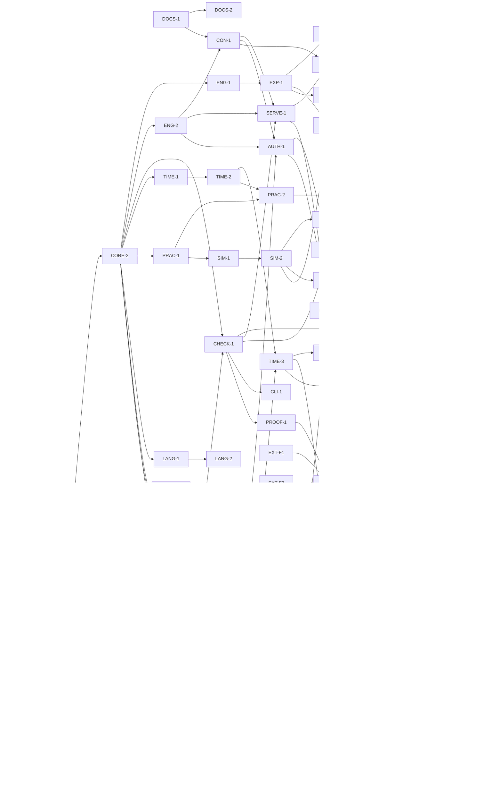

# The plan

This plan is a **dependency graph**, not a schedule. There are no durations
anywhere in it — not because they are unknown, but because a duration is the
wrong instrument for work that parallelizes. The graph's shape is the point:
where it is wide, many nodes run at once; where it is a chain, one artifact
truly consumes another. The build's rate is set by how wide the frontier is, so
the plan optimizes for width and states the frontier explicitly.

The decision ledger (`decisions.md`) outranks this plan. A node's oracle is how
we know the node is done; a milestone is a set of nodes, never a date.

## Node schema

Each node carries:

- **id** — a lane-prefixed identifier (`CORE-2`, `TIME-3`).
- **deliverable** — the artifact the node produces.
- **needs** — the nodes whose artifacts this node consumes. **An edge exists
  only when B consumes A's artifact** — not for thematic affinity, not for
  "related to." If B could start with A merely planned, there is no edge.
- **produces** — what downstream nodes consume from this one.
- **oracle** — the concrete check that closes the node. A node without a
  falsifiable oracle is not a node.
- **lane** — the concern it belongs to (one of nineteen).
- **external** — true when the node is delivered by another party (the author's
  rulings, the fantasy repo); **deferred** when the node is parked behind a
  named flip condition and is not built at v1.

## The nineteen lanes

| Lane | Concern |
|---|---|
| `store` | Lorestore: the embedded fact store, the JSON-first cutover (DL-0041). |
| `distribution` | Archive-scale peer/service boundary, Magic-Set routing, and managed delivery (DL-0062). |
| `infra` | Repository scaffold, the `cargo xtask gate`, CI lanes. |
| `docs` | The lead documentation and the spec suite. |
| `core` | AST, JSON Schema, the annotated evaluator, the verdict lattice, the loader/front-end. |
| `query` | The query engine and the fork manager. |
| `check` | Continuity (six classes) and factcheck. |
| `time` | Partial order, fluents, episode anchors, order-rules. |
| `practice` | Magic/practice parameterization and ledger checking. |
| `sim` | The practice simulator and the Turning engine. |
| `language` | Registers, morphemes, names, terms. |
| `episode` | The episode schema (delta + story-time anchors). |
| `craft` | The outline port, the craft-rule engine, the KB. |
| `attestation` | The LLM boundary and the attestation store. |
| `payload` | The fat-payload pipeline. |
| `surface` | Formatter, error ladder, reference cards, the grammar gate, and the authoring benchmark. |
| `serve` | The contract, the server, the CLI, and the tool-surface authoring tools. |
| `export` | The portability/export layer. |
| `assurance` | The proof (mutation) harness, the differential oracles, and the source migration. |

Nodes marked **external** or **deferred** are placed in the lane whose artifact
they touch; they are not a lane of their own.

## Release priority

The current priority is the fiction-release reset (DL-0101), which sits
outside this graph. The task list is `docs/release/HANDOVER.md` and the
target is `docs/release/north-star.md`. The four-suite benchmark evidence
program that used to be named here is retired. The distribution nodes below
(DIST-*) are parked with no trigger, and the scrub tasks retire or remove the
BENCH-*, SURF-4 and TPtH-bound nodes.

## The node registry

### `infra`

- **INFRA-1** — Repository scaffold: cargo workspace, `cargo xtask gate`
  (CI-parity as a compiled Rust test), the three git-orchestration scripts, and
  the deterministic offline CI lanes.
  *Needs:* none. *Produces:* the buildable tree and the gate. *Oracle:* `cargo
  xtask gate` is green on the scaffold; the deterministic CI lanes pass with no
  network.

### `docs`

- **DOCS-1** — The lead documentation set: charter, decision ledger, this plan,
  and the integration contract.
  *Needs:* none. *Produces:* the settled decisions the specs elaborate.
  *Oracle:* every doc carries `status` + `verdict` frontmatter; the ledger is
  present and single-writer.
- **DOCS-2** — The spec suite: `spec/00-overview.md`, the per-lane specs, and
  the design notes.
  *Needs:* DOCS-1. *Produces:* the buildable spec of each lane. *Oracle:* every
  spec has frontmatter; every fenced example passes the docs-oracle (the real
  parser, `dli_syntax::parse_document`, over every fenced `.dli` block and
  every committed example).
- **EXT-A1** — *(external — author.)* The author's standing ruling queue filed
  as live ruling requests: the migration RQ batch and the Turning RQs.
  *Needs:* none. *Produces:* the queue the author rules against. *Oracle:* the
  RQs are live in the **consuming fantasy repo's** `docs/rulings/` and surfaced
  in its review queue (that repo's convention — deloreis keeps a flat docs
  tree, DL-0011).

### `core`

- **CORE-1** — AST types + the schemars-derived JSON Schema + the
  recursive-descent parser skeleton.
  *Needs:* INFRA-1. *Produces:* the normative AST and its schema. *Oracle:* the
  schema is derived from the types (no drift); AST↔canonical round-trips;
  insta-snapshotted.
- **CORE-2** — The annotated seminaive evaluator: condition polynomials, the
  grade lattice, annotation-aware delta semantics, absorption normalization at
  every join, and the inverted provenance indexes.
  *Needs:* CORE-1. *Produces:* assertability, closures, support reads. *Oracle:*
  T1/T2 (status derivation, transitive closures) over real canon; differential
  agreement with the legacy gates.
- **CORE-3** — The verdict lattice: `checked > tested > attested > asserted`, the
  two-channel support/grade semantics, and weakest-grade rollup over the
  procedure chain.
  *Needs:* CORE-1. *Produces:* graded verdicts. *Oracle:* rollup is the minimum
  over the procedure chain, never over citations; judgments replay identically.
- **FRONT-1** — The loader/front-end: canon fronted as AST, with
  range-restriction and stratification (negative-dependency acyclicity) checked
  at load.
  *Needs:* CORE-1. *Produces:* the loaded, well-formed world. *Oracle:* real
  canon loads; a cyclic negative dependency is a load-time finding.
- **DEF-3** — *(deferred.)* The SMT seat.
  *Needs:* none. *Produces:* nothing until triggered. *Oracle:* the trigger — a
  ratified arithmetic law — is documented; the seat is not built at v1.
- **DEF-4** — *(deferred.)* Multi-authority valuation (per-author valuations, a
  merge policy). Explicitly outside v1.
  *Needs:* none. *Produces:* nothing until triggered. *Oracle:* the
  single-authority limit is documented as the standing boundary.

### `query`

- **ENG-1** — The query engine (`query`, `--layer/--as-of/--fork/--why`) with
  blame / min-why / why-not.
  *Needs:* CORE-2. *Produces:* queries and dependency reads. *Oracle:* `--why`
  renders the support antichain; blame reads the defeater.
- **ENG-2** — The fork manager (`fork new/suppose/add/diff/promote`,
  `preflight`).
  *Needs:* CORE-2. *Produces:* forks and derived-consequence diffs. *Oracle:*
  forks are O(1); `diff` is a derived-consequence diff; `preflight` is a
  candidate-valuation evaluation with a conflict scan.

### `check`

- **CHECK-1** — Continuity (the six classes) + factcheck (claims →
  supported/contradicted/unsupported with D-citations; rejected-lore constraints
  enforced).
  *Needs:* CORE-2, FRONT-1. *Produces:* the world-check battery. *Oracle:*
  shadow-read parity against the legacy continuity and factcheck oracles.

### `time`

- **TIME-1** — The partial-order module: the era spine, before-facts,
  `happens-before` as a kernel rule under CI, cycle blame, and `unordered` as a
  first-class verdict.
  *Needs:* CORE-2. *Produces:* the ordered chronology. *Oracle:* a before-cycle
  is reported as blame; an undeclared pair answers `unordered`, never a
  tie-break.
- **TIME-2** — Fluents: validity spans (`since/until/during`), the cautious
  three-valued projection, and `state-at`.
  *Needs:* TIME-1. *Produces:* time-anchored facts. *Oracle:* D-0114
  water-status checks clean in both eras (the pre-enclosure flashback and the
  story-present episode), with no false contradiction.
- **TIME-3** — Episode anchors + order-rules + slack (earliest/latest legal slot)
  + the offset→before migration compiler.
  *Needs:* TIME-2, EPI-1. *Produces:* the checked episode order. *Oracle:*
  order-rules check by linear scan; slack is a forward/backward pass; the
  compiler emits before-facts with adjacent citations.
- **DEF-1** — *(deferred.)* The owned episode-order searcher (topological +
  chronological backtracking + window forward-checking).
  *Needs:* TIME-3. *Produces:* nothing until triggered. *Oracle:* the flip
  condition — a real propose-orderings workflow with soft/disjunctive
  constraints — is documented; every found order re-passes the TIME-3 checker.

### `practice`

- **PRAC-1** — Practice parameterization: typed sorts (including the `wheel`
  sort), the closed resource algebra (`linear`/`affine`/`graded monotone`), side
  conditions, and error-class declarations that refine the seven structural
  classes.
  *Needs:* CORE-2. *Produces:* declared practices (magic systems). *Oracle:*
  practice well-formedness holds; the `true-naming` fixture is the acceptance
  test (a second, structurally disjoint practice hosts with no kernel code).
- **PRAC-2** — The ledger checker (`check-proof in <practice>`): the premise-pool
  projection (`certain ∩ known-by-speaker ∩ present`), the linear accounting,
  and the expected-verdict discipline.
  *Needs:* PRAC-1, TIME-2. *Produces:* diegetic proof verdicts. *Oracle:* the
  spoken-proof scene checks; a slack-tide ward in a flood-bound scene is a
  wrong-hour (L3 timing) error.

### `sim`

- **SIM-1** — The practice simulator (`simulate`): batteries over a declared
  practice with declared metrics and invariants, checkpointing, and run
  manifests.
  *Needs:* PRAC-1. *Produces:* graded simulation results. *Oracle:* an exact
  bookkeeping invariant grades `checked`; a Monte-Carlo claim grades `tested`
  with its counts.
- **SIM-2** — The Turning engine: deck structure, legal-move relations, terminal
  conditions, variants-as-deltas, invariant enumeration, and the honest-vs-rigged
  study.
  *Needs:* SIM-1. *Produces:* the ratifiable ruleset and its study. *Oracle:*
  legal-move enumeration under deltas; the D-0147→D-0148 fork/ratify replay.
- **EXT-A2** — *(external — author.)* The author ratifies a Turning ruleset.
  *Needs:* SIM-2. *Produces:* the ruleset the export compiles. *Oracle:* a
  D-entry ratifies the ruleset; the ledger records the surfacing run.
- **DEF-2** — *(deferred.)* The owned generative enumerator over delta schemas
  (backtracking pruned by the kernel's exact invariant checker).
  *Needs:* SIM-2. *Produces:* nothing until triggered. *Oracle:* the flip
  condition — ruleset legality opened generatively — is documented;
  pruning-by-checker is the design.

### `language`

- **LANG-1** — Register / morpheme / name / term declarations with bundle
  provenance (one hypothesis variable per proposal bundle).
  *Needs:* CORE-2. *Produces:* the language packs. *Oracle:* the registers port
  one-to-one from the legacy data; a name is a typed derivation citing its
  register and composition.
- **LANG-2** — The derivation checker (phonotactics + slot grammars) + name-space
  queries + the generated ratified-names view + aural distinctness.
  *Needs:* LANG-1. *Produces:* the compiled name-space (the mirror's successor).
  *Oracle:* shadow-read parity against the legacy vet on the ratified names and
  the batch-001 candidates; a colliding declaration fails `deloreis check`.

### `episode`

- **EPI-1** — The episode schema: the delta form + story-time anchors (`at`,
  after/before, phase bindings), scenes with cast/presence, and knowledge
  fluents.
  *Needs:* CORE-1. *Produces:* the episode fold inputs. *Oracle:* the fold runs
  in production order; a flashback scene carries its own anchor and folds
  correctly.

### `craft`

- **CRAFT-1** — The outline schema port: `EpisodeOutline` and `EpisodeState`
  merged into season-wide first-class objects (promises, beats, scenes, sliders,
  knowledge).
  *Needs:* EPI-1. *Produces:* the season ledger objects. *Oracle:* `outline.py`
  is the parity oracle; the violation codes port intact.
- **CRAFT-2** — The craft-rule engine over the season ledger, sharing one
  evaluator with the order-rules.
  *Needs:* CRAFT-1, TIME-3. *Produces:* season-scope craft findings. *Oracle:*
  the earned-outcomes join (a major accomplishment requires a prior failure on
  the same thread); competence-consistency over slider fluents.
- **CRAFT-3** — The KB port as `principle` declarations, with check-ref
  resolution as a compile check and judge-bound principles consuming
  attestations.
  *Needs:* CRAFT-2, ATT-1. *Produces:* the principle-cited findings and the
  checkable-debt report. *Oracle:* a `tension` without a resolution is a compile
  error; a `checkable judge` principle reports grade `attested`.

### `attestation`

- **ATT-1** — The attestation store + `attestation-missing` findings + the
  `attested`-grade consuming checks.
  *Needs:* CORE-3. *Produces:* the graded model-judgment layer. *Oracle:* the
  store is append-only per question; a check lacking its attestation reports
  `attestation-missing`, never a guess; no consensus lifts the grade.

### `payload`

- **PAY-1** — The payload schema + the quote-anchor verification.
  *Needs:* EPI-1. *Produces:* the draft's structured shadow. *Oracle:* a quote
  that does not appear verbatim at its claimed line is a hard error.
- **PAY-2** — `check-draft`: the full battery over one payload + the single
  merged report.
  *Needs:* PAY-1, CHECK-1, PRAC-2, CRAFT-2. *Produces:* the merged draft report.
  *Oracle:* one report; every finding carries rule/check id + grade, and every
  source-anchored finding carries its draft line + verbatim quote.
- **PAY-3** — Outline-conformance as a two-sided diff
  (`beat-unaccounted`/`beat-undeclared`, over promises, casts, and cues).
  *Needs:* PAY-2, CRAFT-1. *Produces:* the conformance findings. *Oracle:* an
  outline-promised-but-payload-absent beat and a payload-present-but-undeclared
  beat both surface, each stating both readings.

### `surface`

- **SURF-1** — The formatter: the single canonical rendering (write sloppy, save
  canonical), gate-enforced.
  *Needs:* CORE-1. *Produces:* canonical surface. *Oracle:* the canonical form
  is idempotent; non-canonical text is legal input, never legal repo state.
- **SURF-2** — The graded error ladder: domain-speaking diagnostics via miette.
  *Needs:* CORE-2, SURF-1. *Produces:* the error surface. *Oracle:* diagnostics
  speak the domain (a missing ruling, not "unbound identifier");
  insta-snapshotted.
- **SURF-3** — The reference cards (gentle subset + expert tier) + the
  human-writer probe protocol.
  *Needs:* SURF-1. *Produces:* the teaching surface. *Oracle:* every gentle-subset
  example on the first card compiles; no expert-tier word appears on the first
  card.
- **SURF-4** — The grammar gate (G1): freeze the AST schema, ship the surface +
  formatter + reference cards + benchmark surface-tasks.
  *Needs:* SURF-1, SURF-2, SURF-3, BENCH-1. *Produces:* the frozen surface.
  *Oracle:* the AST schema is frozen; the surface tasks pass; the human-writer
  probe has run before the freeze.
- **BENCH-1** — *(deferred.)* The authoring benchmark harness: two authoring routes × models,
  the two demoted conditions as arms, pass defined by the real gate's verdict.
  *Needs:* CORE-2, SURF-1. *Produces:* the benchmark rig. *Oracle:* the pass
  criterion is the gate verdict; reference examples are CI-compiled. *Flip
  condition (DL-0022):* built when the human-writer probe (`docs/cards/probe-protocol.md`)
  is prioritized and a live-LLM route-decision run is authorized — Bedrock-only,
  hard spend cap, CI-quarantined. See `design-notes/bench-deferral.md`.
- **BENCH-2** — *(deferred.)* The two-route benchmark run and report: the text
  surface and the tool surface as the primary arms, raw text editing and raw AST
  emission as demoted arms.
  *Needs:* BENCH-1, AUTH-1, SERVE-1. *Produces:* a verdict about which route to
  keep shut. *Oracle:* the report yields a route decision, never a menu. *Flip
  condition (DL-0022):* runs after BENCH-1 lands; gates SURF-4 (the grammar
  freeze). See `design-notes/bench-deferral.md`.

### `serve`

- **CON-1** — The `contracts/dli-worker` contract: the schemas, the op/tool
  inventory, and the closed fixture registry.
  *Needs:* DOCS-1, ENG-2. *Produces:* the boundary the server and fantasy share.
  *Oracle:* an op or tool without golden + negative + framing fixtures does not
  exist; verdict parity holds across the fixtures.
- **SERVE-1** — `deloreis serve`: the MCP / JSON-over-stdio server carrying the
  batch `dli.*` operations.
  *Needs:* CON-1, ENG-2, CHECK-1. *Produces:* the running server. *Oracle:*
  golden/negative/framing fixtures pass; the envelope carries no timestamps and
  rejects unknown fields.
- **CLI-1** — The `deloreis` CLI: `check`, `query`, `fmt`, `fork`, `preflight`,
  `timeline`, `simulate`, `export`, `name`, `craft why`, `check-proof`,
  `check-draft`, `report`, `serve`, `mcp`.
  *Needs:* CHECK-1. *Produces:* the command surface. *Oracle:* the man-page
  operations run; exit codes reflect verdicts.
- **AUTH-1** — The authoring tool surface: the workspace/staging engine, the
  `author.*` tools, per-tool golden/negative/framing fixtures, and immediate
  graded findings on every mutating call.
  *Needs:* CON-1, ENG-2, FRONT-1. *Produces:* the tool surface. *Oracle:* the author-session
  golden fixture passes end to end; the framing-attack fixture leaves verdicts
  unchanged.
- **AUTH-2** — The worked TPtH (*To Pleach the Hedgeway*, the consuming
  audio-drama project) scenario against the pinned fantasy corpus.
  *Needs:* AUTH-1, CHECK-1, EXT-F2. *Produces:* the CP-10 handshake fixture — a
  golden fixture encoding the `migration.md` §10 scenario against the vendored
  corpus. *Oracle:* that fixture replays green (the seed `author-session`
  fixture covers the tool flow only, over the example world).
- **EXT-F3** — *(external — fantasy.)* The fantasy worker adapts to call `deloreis
  serve` (class-declared LLM calls, quote anchors, job wrapping, the digest
  check).
  *Needs:* CON-1, SERVE-1. *Produces:* the fantasy-side integration. *Oracle:*
  the fantasy worker speaks the contract against the vendored, digest-checked
  copy.
- **EXT-F4** — *(external — fantasy.)* The fantasy agent exercises the tool-surface
  worked scenario against the tagged build and posts the transcript (CP-10).
  *Needs:* AUTH-2. *Produces:* the acknowledged handshake. *Oracle:* the
  transcript matches the fixture semantics.

### `export`

- **EXP-1** — The export core (`export --profile <target>` at the CLI; explicit
  registry and valuation options in the library): one-way compiles from the
  certain layer, with a manifest.
  *Needs:* ENG-1. *Produces:* the export backend spine. *Oracle:* an export reads
  the certain layer and fails closed on proposed lore; the manifest traces every
  artifact to its exact canon state.
- **EXP-2** — The context-pack backend (the first export backend, formalized).
  *Needs:* EXP-1. *Produces:* the audio-script context packs. *Oracle:* it
  reproduces today's context-pack output.
- **EXP-3** — The card/board profile (the Turning deck as a card set) and the
  structural Ludii L-GDL profile.
  *Needs:* EXP-1, SIM-2. *Produces:* the game content sets. *Oracle:* the three
  deck recompiles (honest, salt-fringe, keep-stamped) — the keep-stamped deck
  loses `the-debt-square` from the compile; every selected component,
  legal-move edge, and terminal layout renders with hostile strings contained.
- **DEF-5** — *(deferred.)* The live Ludii trace-agreement differential.
  *Needs:* EXP-3. *Produces:* the rented-runtime soundness audit. *Oracle:* the
  `deloreis` simulator and Ludii agree on legal moves and terminal verdicts over
  the same seeded battery. The structural export records this lane as pending
  until a live Ludii runtime is provisioned outside the deterministic gate.
- **EXP-4** — The video-game (articy-shaped JSON) and free-rider (CSV, static
  wiki) profiles.
  *Needs:* EXP-1. *Produces:* the remaining export targets. *Oracle:* typed
  entities with who-may-know-what scopes; citations travel as dev-metadata,
  stripped for ship.

### `assurance`

- **PROOF-1** — The mutation harness: seeded-violation operators × the real
  gates; every check gets operators.
  *Needs:* CHECK-1. *Produces:* the gate-coverage proof. *Oracle:* every operator
  is caught; honest misses are xfail-strict, never hidden.
- **PROOF-2** — The differential-oracle harness: the legacy gates as reference
  oracle now, the clingo baseline lab-side.
  *Needs:* CORE-2. *Produces:* the standing differential. *Oracle:* the legacy
  Python gates and the kernel are diffed; disagreements are findings.
- **MIG-1** — The facts.yaml replay with stored-status cross-checks.
  *Needs:* FRONT-1. *Produces:* the read-through of the legacy corpus. *Oracle:*
  the stored `status:` is cross-checked against what the kernel derives from
  `decisions:`; any disagreement is a finding, not a silent fix.
- **MIG-2** — The shadow-read harness: pinned oracles, vendored corpus snapshots,
  and the mutation detection corpus (detection proven separately from parity).
  *Needs:* MIG-1, PROOF-1, EXT-F1, EXT-F2, EXT-F5. *Produces:* the dual-run
  evidence. *Oracle:* the detection corpus proves the harness catches seeded
  divergence before any parity run counts.
- **MIG-3** — The three-phase source migration (facts / timeline / characters →
  `lore/*.dli`), ending in deletion of the legacy source.
  *Needs:* MIG-2, EXT-A1. *Produces:* the migrated `.dli` corpus. *Oracle:*
  per-check flip (20 consecutive clean dual-runs + one real ruling propagated —
  the ruling the author makes against EXT-A1's queue + detection parity); the
  conversion diff is reviewed; the source is deleted, not mirrored.
- **MIG-4** — The era-split + the offset→before migration, filed as one batch
  ruling request.
  *Needs:* MIG-3, TIME-3. *Produces:* the ratified intra-era order and the
  narrative-layer split. *Oracle:* the acts leave the chronology spine; the batch
  RQ ratifies the intra-era order the author has not previously ruled.
- **VAL-1** — The native repository validator (`deloreis validate-repo`) and its
  detection corpus: eleven codes — V1–V8, V10–V12 — a governance home, and a
  finding-shape promise the consuming project's shadow-validate harness compares
  against. There is no V9 (DL-0057): it closed by absorption, its status-leak
  half a theorem in `dli-core` derivation support and its row-discipline half the
  MIG-1 replay legs.
  *Needs:* INFRA-1. *Produces:* the deloreis half of the shadow-validate
  handshake — the detection corpus, the legacy↔native mapping table, and the
  stable finding shape. *Oracle:* a committed baseline canon repository
  validates to the empty finding list, and every emitted code has at least one
  seeded-divergence operator whose **exact** finding set (path, line, code,
  message fragment) replays offline; the emitted code set is read out of the
  validator's own source, so a new code with no operator fails the gate.
- **EXT-F1** — *(external — fantasy.)* The pinned legacy oracles (`fantasy
  validate`, factcheck, continuity at a pinned SHA).
  *Needs:* none. *Produces:* the reference oracles for shadow-read. *Oracle:* the
  pinned oracle build is reproducible.
- **EXT-F2** — *(external — fantasy.)* The vendored corpus snapshots (canon at a
  pinned commit).
  *Needs:* none. *Produces:* the frozen corpus for dual-run. *Oracle:* the
  snapshot is committed with its content hash.
- **EXT-F5** — *(external — fantasy.)* The mutation detection corpus (known
  divergent cases that a sound shadow-read must catch).
  *Needs:* none. *Produces:* the detection evidence input. *Oracle:* the corpus
  contains seeded divergences with expected catches.

### `store`

The lorestore cutover (DL-0041). The staged plan with full design rules,
theory grounding, and the risk register is
`design-notes/lorestore-roadmap.md`; these nodes are its skeleton.

- **LS-0** — Ratify the pivot: DL-0041, the law updates in `AGENTS.md`, this
  lane, and the consolidation pointers in the four source notes.
  *Needs:* none. *Produces:* the authority every later store node cites.
  *Oracle:* `cargo xtask authority` and the docs-oracle are green; DL-0041
  names the superseded clauses of DL-0003 and DL-0029.
- **LS-1** — The fact-object model: Rust types + schemars JSON Schemas for
  `FactObject`/`Commit`/`Ref`/`EvidenceEnvelope`, JCS canonical bytes, SHA-256
  identity, the three-way identity split (content-hash versions, minted claim
  ids, provenance-bearing lineage edges), canonical polynomial DNF, no floats,
  `schema_version` + upcast-on-read.
  *Needs:* LS-0. *Produces:* the normative stored-object schema. *Oracle:*
  total lowering — the vendored corpus lowered to fact objects compiles to the
  identical fixpoint, findings, and digests.
- **LS-2** — The lorestore crate MVP: loose-object store, refs with valuation
  overlays, append-only commit log, CAS ref updates, advisory lock, crash-safe
  write ordering, filesystem-only storage trait; workspace digest becomes the
  root commit hash; no secondary indexes, no branches beyond main.
  *Needs:* LS-1. *Produces:* durable deterministic persistence. *Oracle:*
  cross-platform root-hash determinism; crash injection never tears the store;
  `state ≡ fold(commit log)` property-tested.
- **LS-3** — The read path: `dli_world::compile` from lorestore; the one-way
  `.dli → lorestore` import tool; config-selected dual backend.
  *Needs:* LS-2. *Produces:* worlds compiled from stored facts; the migration
  path. *Oracle:* differential parity — `.dli` source and its import compile
  identically.
- **LS-4** — The write path: mutating `author.*` tools write fact objects
  directly; `author.materialize` returns JSON by default with `.dli` opt-in;
  contract 0.6.0, additive and dual-mode; the killed-form registry enforced at
  the server layer.
  *Needs:* LS-3. *Produces:* the tool surface backed by lorestore. *Oracle:* re-recorded
  golden/negative/framing fixtures green; a 0.5.1 consumer still passes.
- **LS-5** — The query and review contract: the JSON response schema carrying
  bindings, provenance antichain, grade, and `(root_hash, valuation)`; the
  MCP-served structured-diff/review contract (deloreis ships no review UI —
  rendering is consumer-owned).
  *Needs:* LS-4. *Produces:* replayable verdicts; the review data that
  replaces git-diff-of-text. *Oracle:* a stored result replays byte-identical
  from `(root_hash, valuation, query)`; a golden review-flow fixture drives a
  seeded change-set through the JSON contract alone.
- **LS-6** — The merge engine: commit DAG with merge commits, 3-way merge over
  fact sets, conflict detection confined to valuation disagreement, constraint
  violations, and stratified-negation effects.
  *Needs:* LS-5. *Produces:* persistent divergent worlds with deterministic
  reconciliation. *Oracle:* merge commutes and associates up to root-hash
  equality on conflict-free corpora; the seeded-conflict corpus catches all
  three conflict classes.
- **LS-9** — Expert-tier structuring: typed interiors for the eleven
  string-bodied declaration types; downstream semantic parses in `dli-world`,
  `dli-ledger`, and `dli-time` become typed-AST constructors; stored facts
  upcast from the v1 string-bodied schema. (Id out of sequence: found by the
  coupling audit after LS-0..LS-8 shipped; DAG position is LS-1 → LS-9 → LS-7.)
  *Needs:* LS-1. *Produces:* an AST that is AST all the way down; the
  condition for retiring the parser. *Oracle:* no crate outside `dli_syntax`
  parses stored data; `validate_proof_decl`'s format-and-reparse round-trip is
  replaced by a structural validator; upcasted corpora compile identically.
- **LS-7** — Surface retirement: `dli_syntax` feature-gated out of the default
  build as a pretty-printer; cards rewritten around tools + JSON; the
  docs-oracle re-aimed at fenced `json` against the LS-1 schemas; the
  text-on-wire remnants (`fork.add` strings, wire query goals) retired through
  the killed-form registry.
  *Needs:* LS-4, LS-5, LS-9. *Produces:* the deprecation note's phases 2–3.
  *Oracle:* the default build does not link `dli_syntax`; every fenced doc
  example remains machine-checked throughout; killed-form entries cover every
  retired surface form.
- **LS-8** — Contract 1.0 and consumer cutover: the JSON-first major version;
  the fantasy consumer migrates off vendored 0.5.1. The node splits along the
  ownership boundary. The **local half is complete**: `1.0.0` is minted and
  accepted alongside the whole `0.x` prefix, and the LS-7 field-level
  killed-form registry is live at the 1.0 major — a two-sided retirement off
  one table, the string form refused from 1.0 and still required below it. The
  **cutover half is EXT-F4**, and this repo cannot write it.
  *Needs:* LS-4, LS-5, LS-6, LS-7, EXT-F4. *Produces:* one storage model, one
  interchange format, one review surface. *Oracle:* the consumer speaks 1.0
  against the vendored digest-checked copy; 0.5.1 dual-mode paths retire
  through the killed-form registry — *after* EXT-F4, never before.
- **LS-10** — Incremental compilation (indexing-note Phase 3): for fact additions,
  reuse the prior fixpoint and recompute above the affected stratum, behind an
  in-process rebuildable compiled-world cache, so `author.merge`/`compile_at`
  recompute cost tracks the delta, not the whole world. Entered ahead of Phase 2 on
  the continuous-ingestion trigger (DL-0087); persistent on-disk indexes and a
  sliced check battery are deferred.
  *Needs:* LS-6. *Produces:* delta-time incremental compile at the atelier tier.
  *Oracle:* a permanent gate-resident differential + confluence regression —
  incremental compile equals full recompile byte-identically under **every** addition
  ordering, over a nontrivial world, with threshold coverage counters; the full
  recompile stays the runtime fallback.

### `distribution`

The archive destination is specified in `spec/12-scale-and-distribution.md`.
These nodes are deliberately deferred: the embedded engine remains the
certifying implementation until real benchmark traces or an archive deployment
need the seam.

- **DIST-1** — *(deferred.)* In-process peer/service loopback: separate the
  peer, transactor, and segment-router roles without adding a network. The
  request is pinned to `(root, goal, valuation)` and the response carries a
  manifest of content-addressed inputs.
  *Needs:* LS-5. *Produces:* the semantic segment boundary. *Oracle:* the
  loopback route and whole-corpus evaluator produce byte-identical bindings,
  standings, and provenance over the same fixture roots. *Trigger:* a benchmark
  adapter records a representative query/update trace, or an archive deployment
  needs the seam.
- **DIST-2** — *(deferred.)* Supplementary-Magic-Set segment router over
  indexed base facts. It derives complete, goal-relevant provenance clusters
  rather than a final answer or an interactive table.
  *Needs:* DIST-1. *Produces:* bounded-cluster construction. *Oracle:* a
  generated corpus suite compares every routed cluster's peer evaluation with
  complete-corpus evaluation and rejects a deliberately incomplete cluster.
- **DIST-3** — *(deferred.)* Content-addressed peer cache and local hot-core
  materialization. Cached immutable objects may be reused across roots only
  through a manifest; valuation overlays remain local.
  *Needs:* DIST-1. *Produces:* cache-safe autonomous peer reads. *Oracle:*
  cold, warm, and evicted-cache executions agree byte-for-byte for the same
  `(root, goal, valuation)`.
- **DIST-4** — *(deferred.)* Managed transport/object backend and serialized
  transactor. It replaces loopback I/O without moving certification or
  application policy into the service.
  *Needs:* DIST-2, DIST-3. *Produces:* peer/service conformance over a remote
  deployment. *Oracle:* the remote route passes the DIST-1 exactness corpus and
  an offline peer can replay every captured manifest without network access.

## The dependency graph

Nodes with no incoming edge are roots: INFRA-1, DOCS-1, EXT-A1, EXT-F1, EXT-F2,
EXT-F5 (the zero-state runnable frontier), plus the deferred DEF-3 and DEF-4.
The store lane joined after the standalone release closed (DL-0038, DL-0041)
and is now complete locally. The distribution lane is a later, deferred chain;
the status matrix, not this historical zero-state graph, is the current release
authority.

## The frontier

The tables below preserve the DAG's **zero state** — the frontier before any
node completes. For the state of this tree, use the machine-checked node matrix
after the graph; it is the release-status authority.

**Six nodes are runnable at zero** — nothing must precede them:

- Internal: **INFRA-1**, **DOCS-1**.
- External: **EXT-A1** (the author's ruling queue), **EXT-F1** (pinned oracles),
  **EXT-F2** (vendored corpus), **EXT-F5** (detection corpus).

The frontier then widens sharply, because the core is a fan-out, not a chain:

| After this completes | Newly runnable | Frontier shape |
|---|---|---|
| INFRA-1 | CORE-1; (DOCS-2 after DOCS-1) | narrow — the core is one node deep |
| CORE-1 | CORE-2, CORE-3, FRONT-1, EPI-1, SURF-1 | five-wide fan-out from the AST |
| CORE-1..3 + FRONT-1 | ENG-1, ENG-2, CHECK-1, TIME-1, PRAC-1, LANG-1, ATT-1, SURF-2, BENCH-1, PROOF-2, MIG-1 (SURF-3 after SURF-1) | **the ~10-wide plateau** — most lanes open at once and run in parallel |
| ENG-2 + FRONT-1 + CON-1 | **AUTH-1 joins the frontier** (the tool surface opens) | the serve lane and the benchmark converge |
| TIME-2 + EPI-1 | TIME-3; then CRAFT-2, MIG-4 | the time and craft lanes deepen |
| SIM-1 | SIM-2; then EXP-3, EXT-A2 | the game and export lanes |

The ~10-wide plateau after CORE-1..3 is the plan's whole shape argument: once
the AST, the evaluator, the verdict lattice, and the loader exist, eleven nodes
across nine lanes are simultaneously unblocked. The build's rate from there is
set by how many of them run at once, not by any single node's length.

## Node status matrix

`cargo xtask authority` requires every registry node to appear exactly once
with one of four states. `done` means the node's stated oracle is replayable in
this tree. `open` means local engineering remains. `deferred` names work parked
by a ledger ruling or explicit release boundary. `external-blocked` requires an
author or consumer artifact that this repository does not own.

| Node | State | Evidence |
|---|---|---|
| INFRA-1 | done | `cargo xtask gate` |
| DOCS-1 | done | `cargo xtask authority` and `cargo xtask docs-oracle` |
| DOCS-2 | done | `cargo xtask docs-oracle` |
| EXT-A1 | external-blocked | Author ruling queue is owned by the consuming project |
| CORE-1 | done | `cargo test -p dli-ast -p dli-syntax` and schema gate |
| CORE-2 | done | `cargo test -p dli-eval` |
| CORE-3 | done | `cargo test -p dli-core -p dli-eval` |
| FRONT-1 | done | `cargo test -p dli-world` |
| DEF-3 | deferred | DL-0005 arithmetic-law trigger has not fired |
| DEF-4 | deferred | v1 remains single-authority |
| ENG-1 | done | `cargo test -p dli-eval --test query` |
| ENG-2 | done | `cargo test -p dli-eval --test fork` |
| CHECK-1 | done | `cargo test -p dli-world` |
| TIME-1 | done | `cargo test -p dli-time` |
| TIME-2 | done | `cargo test -p dli-time` |
| TIME-3 | done | `cargo test -p dli-time` |
| DEF-1 | deferred | No soft or disjunctive propose-order workflow has triggered it |
| PRAC-1 | done | `cargo test -p dli-ledger` |
| PRAC-2 | done | `cargo test -p dli-ledger` |
| SIM-1 | done | `cargo test -p dli-sim` |
| SIM-2 | done | `cargo test -p dli-game` |
| EXT-A2 | external-blocked | Final author ratification remains consumer-owned |
| DEF-2 | deferred | Generative legality has not triggered the enumerator |
| LANG-1 | done | `cargo test -p dli-world` language suites |
| LANG-2 | done | `cargo test -p dli-world` name-vet suites |
| EPI-1 | done | `cargo test -p dli-world` episode suites |
| CRAFT-1 | done | `cargo test -p dli-world` craft suites |
| CRAFT-2 | done | `cargo test -p dli-world` craft suites |
| CRAFT-3 | done | `cargo test -p dli-world` principle suites |
| ATT-1 | done | `cargo test -p dli-world` attestation suites |
| PAY-1 | done | `cargo test -p dli-world` payload suites |
| PAY-2 | done | `cargo test -p dli-world --test payload_battery` covers claims, deltas, proof replay, phases, lexicon, craft, and anchors |
| PAY-3 | done | `cargo test -p dli-world` payload suites |
| SURF-1 | done | `deloreis fmt --check examples/ worlds/` |
| SURF-2 | done | syntax and loader diagnostic snapshots |
| SURF-3 | done | docs oracle over reference-card examples |
| SURF-4 | deferred | retired by DL-0041 — no grammar freeze will occur; the text surface closes |
| BENCH-1 | deferred | retired by DL-0041 — the two-route question is answered by events |
| BENCH-2 | deferred | retired by DL-0041; see BENCH-1 |
| CON-1 | done | `cargo xtask fixtures` and `cargo test -p dli-serve --test fixture_replay` cover all 69 ops with typed schemas and paired framing (46 at CON-1's close; every later additive operation joined with its three fixtures) |
| SERVE-1 | done | `cargo test -p dli-serve --test simulation --test fixture_replay` covers practice/game jobs, durable start/status/cancel, restart, terminal rollback refusal, checkpoint-chain corruption, and capability replay |
| CLI-1 | done | The built Clap graph generates the command reference; `cargo test -p deloreis --test cli --test serve_project` covers every command/help path, positive and negative workflows, and project-backed transport |
| AUTH-1 | done | `cargo test -p dli-serve --test author --test author_read --test fixture_replay` |
| AUTH-2 | done | `cargo test -p dli-serve --test auth2` replays `worlds/tpth/auth2/author-tegwen-v1.json` against the pinned-corpus-backed TPtH project |
| EXT-F3 | external-blocked | Fantasy worker adaptation is consumer-owned |
| EXT-F4 | external-blocked | Fantasy transcript is consumer-owned |
| EXP-1 | done | `cargo test -p dli-export` |
| EXP-2 | done | `cargo test -p dli-export` context-pack suites |
| EXP-3 | done | `cargo test -p dli-game -p tpth` covers three deck materializations, exact profile selection, L-GDL structure, and hostile-string containment |
| DEF-5 | deferred | Live Ludii trace differential is non-gating and not provisioned |
| EXP-4 | done | `cargo test -p dli-export` plus the multi-target `dli.export.run` golden fixture cover Articy, CSV, and static-wiki emission and provenance stripping |
| PROOF-1 | done | mutation harness in `cargo xtask gate` |
| PROOF-2 | done | pinned differential harness and detection tests |
| MIG-1 | done | world loader replay suites |
| MIG-2 | done | vendored snapshots and mutation detection corpus |
| VAL-1 | done | DL-0057; `design-notes/native-repository-validator.md`; `cargo test -p dli-world --test repository_detection` — a clean baseline canon tree plus 26 operators covering all eleven emitted codes (V1–V8, V10–V12) with exact finding sets, no `xfail`. The consumer-side DP-008 X6/X8 items are consumer-owned and claimed by no node here |
| MIG-3 | external-blocked | Consumer source deletion and cutover are consumer-owned |
| MIG-4 | external-blocked | Consumer batch ruling and chronology cutover are not in this release |
| EXT-F1 | done | `worlds/tpth/vendor/fantasy-099e04cd/MANIFEST.txt` |
| EXT-F2 | done | vendored corpus manifests under `worlds/tpth/vendor/` |
| EXT-F5 | done | mutation corpus under `worlds/tpth/mutation/` |
| LS-0 | done | DL-0041; `design-notes/lorestore-roadmap.md`; the law updates in `AGENTS.md` |
| LS-1 | done | tracked work — `design-notes/lorestore-roadmap.md` LS-1 |
| LS-2 | done | tracked work — `design-notes/lorestore-roadmap.md` LS-2; shipped — `src/storage.rs`, `src/lorestore.rs`, `tests/cross_platform_determinism.rs`, `tests/state_fold_invariant.rs`, `tests/crash_injection.rs` |
| LS-3 | done | `compile()` read path, `tests/differential_parity.rs`, `all_fact_hashes()` dedup |
| LS-4 | done | DL-0044 as amended by DL-0045 (per-add lowering via `stage_lorestore`); audit repairs `f39cf12`/`8f3b8db`/`80cfa7d`/`8d19b2f`; DL-0046: contract 0.6.0 dual-mode, JSON-first materialize with `.dli` opt-in, digest regimes split, every vendored 0.5.1 fixture replaying byte-identical |
| LS-5 | done | DL-0046 + DL-0100: `(root_hash, valuation)` context with the full ruled map, one meaning per root_hash field, unfiltered monomial-structured review standing, accept/reject via materialize/discard with staged-group drop, and digest/idempotency-fenced materialize from 0.6.0; `tests/ls5_review.rs` proves byte-identical replay from the materialize commit |
| LS-6 | done | DL-0048; merge commits (additive `merge_parent`), two-parent DAG walk + merge-base, `refs/heads` branches, union+recompile 3-way merge, three-class conflict detection (valuation/constraint/stratified-negation), `author.branch`/`author.merge` at contract 0.6.1; oracles `tests/merge.rs` (confluence incl. the non-monotone stratum + seeded-conflict corpus) + `dli-serve/tests/ls6_serve.rs` |
| LS-7 | done | DL-0050; `dli_syntax` demoted to an opt-in `syntax` feature OFF by default — default build of dli-serve/deloreis links zero `dli_syntax` (proven by a two-build gate matrix), no-parse ratchet 3/3. Docs-oracle validates fenced `json` (#11); typed successors `goal_atom`/`additions`/`atom_expr`/`to_atom_expr` + dormant field-level killed-form (#12/#17, contract 0.6.3→0.6.4); demos served from committed lorestore fact objects (#15); feature-gate across 4 crates (#16); reference cards reframed around JSON (#18). Default build is 1.0-native; `.dli` (projects, formatter, string parse, upcast, CLI) is behind `--features syntax`, which serves the 0.5.1/0.6.x consumer byte-identical until EXT-F4. `dli_syntax` crate kept (phase-4 removal unscheduled). |
| LS-8 | external-blocked | DL-0051; **local half complete; the cutover is consumer-owned and awaits EXT-F4.** Contract `1.0.0` is minted and accepted alongside all of `0.5.1`/`0.6.0`–`0.6.4`; the LS-7 field-level killed-form registry is ACTIVATED at the 1.0 major and wired into `serve::dispatch` above the `author.*`/`dli.*` fork, so a 1.0 request carrying `goal`, `declarations`, or a payload claim's `atom` is refused `killed-form` naming `goal_atom`/`additions`/`atom_expr` — and the typed successor is sent alone, the retired fields having become optional. The retirement is two-sided off one registry: below 1.0 the string form is still **required**, with serde's verbatim `missing field` verdict, so no `0.x` wire moved. Evidence: `dli-serve/tests/ls8_contract_1_0.rs` (fires at 1.0 / dormant on every 0.x, per-version), `tests/default_build.rs` (the same hinge in both build lanes), `golden/contract-1-0-field-retirement-v1` (the dual-mode pair replayed byte-exact on both wires), four `negative/contract-1-0-killed-*` fixtures, `framing/contract-1-0-framing`; every pre-1.0 fixture replays byte-identical under `fixture_replay` with no digest re-pinned. **Not done:** the consumer cutover is EXT-F4, consumer-owned in the fantasy repo. The `0.5.1`/`0.6.x` dual-mode paths are NOT deleted; they retire through the killed-form registry only after EXT-F4. |
| LS-9 | done | DL-0049; all eleven declaration interiors typed (`RuleDecl` DL-0047 + `Practice`/`Proof`/`Dialect`/`NamePart`/`Name`/`Ratify` + five near-empty), `dli_syntax` the single producer via `structure_<type>_body`, `dli-world`/`dli-ledger` typed readers; proof structural validator replaces format-and-reparse; v1→v2 upcast (`deepen_<type>_carriage`) for all eleven; contract 0.6.2; `dli-ledger`+`dli-time` syntax-free (ratchet 2/3). Residual `dli-world` `payload.rs` claim/fact parse is LS-7's load-boundary concern, not a declaration body. Evidence in `design-notes/dli-syntax-coupling-audit.md` |
| LS-10 | open | DL-0087; incremental compilation entered ahead of Phase 2 on the continuous-ingestion trigger (#75/#77). v1: in-process rebuildable compiled-world cache (bounded LRU) + incremental fixpoint reusing the prior saturation (recompute above the affected stratum); persistent on-disk indexes and sliced checks deferred. Safety: permanent gate-resident oracle — incremental compile == full recompile byte-identical under every addition ordering, full recompile the runtime fallback. Staged PRs: dli-eval fixpoint → dli-world compile_incremental → dli-lorestore cache. |
| DIST-1 | deferred | DL-0062; trigger is a benchmark query/update trace or archive deployment need |
| DIST-2 | deferred | DL-0062; waits for DIST-1's segment contract |
| DIST-3 | deferred | DL-0062; waits for DIST-1's segment contract |
| DIST-4 | deferred | DL-0062; waits for routed clusters and peer cache |

## Milestones (node-sets, not dates)

Each milestone is the set of nodes whose completion defines it. Milestones
overlap; the language and craft lanes in particular run alongside the game lane.

- **P0** — INFRA-1, DOCS-1, DOCS-2, CORE-1, CORE-2, CORE-3, FRONT-1, SURF-1,
  BENCH-1. *The kernel crates fronted against real canon; the `attested` grade
  and two-channel rollup present in the core verdict types from the first crate;
  the authoring benchmark harness standing.*
- **M1** — CHECK-1, ENG-1, ENG-2, MIG-1, MIG-2, PROOF-1, PROOF-2, PRAC-1,
  PRAC-2, ATT-1 (with EXT-F1, EXT-F2, EXT-F5 in place). *facts.yaml replay with
  stored-status cross-checks; shadow-read parity with the mutation operators as
  detection corpus; the first Concordance scene; practice parameterization; the
  attestation store.*
- **Time module** — TIME-1, TIME-2, EPI-1, TIME-3, MIG-4. *Partial order,
  fluents, episode anchors, order-rules + slack, the offset→before compiler and
  the batch RQ.*
- **M-craft** — CRAFT-1, CRAFT-2, CRAFT-3. *The outline port with `outline.py` as
  parity oracle; the craft-rule engine over the season ledger; the KB port; the
  new world-and-time-aware rules at warn severity pending calibration.*
- **Language module** — LANG-1, LANG-2. *Register/morpheme/name/term
  declarations with bundle provenance; the derivation checker; the generated
  ratified-names view; shadow-read against the legacy vet.*
- **Payload** — PAY-1, PAY-2, PAY-3. *The payload schema, quote verification,
  the merged battery report, and two-sided outline-conformance.*
- **M2** — SIM-1, SIM-2, EXT-A2. *The Turning engine + battery + honest-vs-rigged
  study; the D-0147→D-0148 fork/ratify replay; the five Turning RQs filed.*
- **G1 (the grammar gate)** — SURF-2, SURF-3, SURF-4, BENCH-2. *Freeze the AST
  schema if it held; the surface + formatter + reference cards + benchmark
  surface-tasks + the human-writer probe; the two-route benchmark verdict.*
  **Retired by DL-0041:** the grammar is never frozen and the two-route verdict
  is answered by events — the text surface closes, the tool surface remains
  (DL-0043 retires the door semantic itself).
- **GDL proof point** — SIM-2, EXT-A2, EXP-3, DEF-5. *The `games/ludii` export
  profile for the ratified Turning ruleset + the trace-agreement differential — the
  external soundness audit of rules-as-lore. Lands after M2, as a data profile,
  once a ratified ruleset exists to export.*
- **Cutover** — MIG-3, MIG-4, EXT-F3, EXT-F4. *The per-check flips; the source
  deletion; the fantasy worker on the vendored contract; the tool-surface handshake
  acknowledged.* Runs on v1 terms (`.dli` + contract 0.5.1) per DL-0041's
  boundary condition — and those terms still hold, because contract `1.0.0` was
  minted **ahead of** the cutover rather than at it (DL-0051, DL-0053): the
  server accepts `0.5.1` through `1.13.0` and answers each caller in the version
  it declared, so the consumer moves when it is ready and the 0.x versions
  retire through the killed-form registry only after EXT-F4.
- **Lorestore core** — LS-0, LS-1, LS-2, LS-3, LS-4, LS-5. *The pivot ratified;
  the fact-object schema as the language definition; the embedded store; the
  dual-backend read path; the tool surface writing the store JSON-first under contract
  0.6.0; the replayable query contract and the structured-diff review contract
  (rendering consumer-owned).*
- **Lorestore completion** — LS-6, LS-9, LS-7, LS-8. *The provenance-aware
  merge engine; the expert-tier interiors structured; the surface retired to
  an optional pretty-printer; contract 1.0 and the consumer's move off
  0.5.1.*
- **Archive peer/service** — DIST-1, DIST-2, DIST-3, DIST-4. *A loopback-first
  peer/service seam, exact supplementary-Magic-Set cluster routing,
  content-addressed peer cache, then managed transport. Deferred by DL-0062
  until external evidence traces or an archive deployment require it.*
