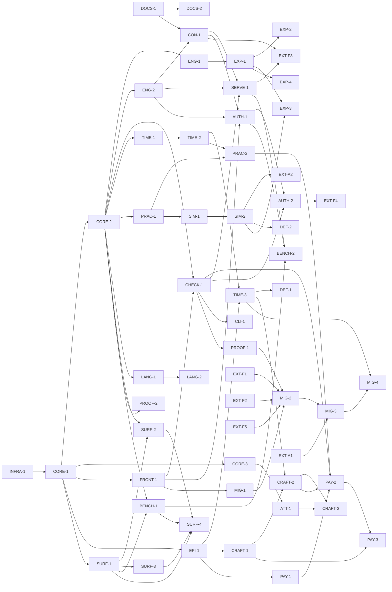

# The plan

This plan is a **dependency graph**, not a schedule. There are no durations
anywhere in it — not because they are unknown, but because a duration is the
wrong instrument for work that parallelizes. The graph's shape is the point:
where it is wide, many nodes run at once; where it is a chain, one artifact
truly consumes another. The build's rate is set by how wide the frontier is, so
the plan optimizes for width and states the frontier explicitly.

The decision ledger (`decisions.md`) outranks this plan. A node's oracle is how
we know the node is done; a milestone is a set of nodes, never a date.

## Node schema

Each node carries:

- **id** — a lane-prefixed identifier (`CORE-2`, `TIME-3`).
- **deliverable** — the artifact the node produces.
- **needs** — the nodes whose artifacts this node consumes. **An edge exists
  only when B consumes A's artifact** — not for thematic affinity, not for
  "related to." If B could start with A merely planned, there is no edge.
- **produces** — what downstream nodes consume from this one.
- **oracle** — the concrete check that closes the node. A node without a
  falsifiable oracle is not a node.
- **lane** — the concern it belongs to (one of seventeen).
- **external** — true when the node is delivered by another party (the author's
  rulings, the fantasy repo); **deferred** when the node is parked behind a
  named flip condition and is not built at v1.

## The seventeen lanes

| Lane | Concern |
|---|---|
| `infra` | Repository scaffold, the `cargo xtask gate`, CI lanes. |
| `docs` | The lead documentation and the spec suite. |
| `core` | AST, JSON Schema, the annotated evaluator, the verdict lattice, the loader/front-end. |
| `query` | The query engine and the fork manager. |
| `check` | Continuity (six classes) and factcheck. |
| `time` | Partial order, fluents, episode anchors, order-rules. |
| `practice` | Magic/practice parameterization and ledger checking. |
| `sim` | The practice simulator and the Turning engine. |
| `language` | Registers, morphemes, names, terms. |
| `episode` | The episode schema (delta + story-time anchors). |
| `craft` | The outline port, the craft-rule engine, the KB. |
| `attestation` | The LLM boundary and the attestation store. |
| `payload` | The fat-payload pipeline. |
| `surface` | Formatter, error ladder, reference cards, the grammar gate, and the authoring benchmark. |
| `serve` | The contract, the server, the CLI, and the Door-T authoring tools. |
| `export` | The portability/export layer. |
| `assurance` | The proof (mutation) harness, the differential oracles, and the source migration. |

Nodes marked **external** or **deferred** are placed in the lane whose artifact
they touch; they are not a lane of their own.

## The node registry

### `infra`

- **INFRA-1** — Repository scaffold: cargo workspace, `cargo xtask gate`
  (CI-parity as a compiled Rust test), the three git-orchestration scripts, and
  the deterministic offline CI lanes.
  *Needs:* none. *Produces:* the buildable tree and the gate. *Oracle:* `cargo
  xtask gate` is green on the scaffold; the deterministic CI lanes pass with no
  network.

### `docs`

- **DOCS-1** — The lead documentation set: charter, decision ledger, this plan,
  and the integration contract.
  *Needs:* none. *Produces:* the settled decisions the specs elaborate.
  *Oracle:* every doc carries `status` + `verdict` frontmatter; the ledger is
  present and single-writer.
- **DOCS-2** — The spec suite: `spec/00-overview.md`, the per-lane specs, and
  the design notes.
  *Needs:* DOCS-1. *Produces:* the buildable spec of each lane. *Oracle:* every
  spec has frontmatter; every fenced example passes the docs-oracle (the real
  parser, `dli_syntax::parse_document`, over every fenced `.dli` block and
  every committed example).
- **EXT-A1** — *(external — author.)* The author's standing ruling queue filed
  as live ruling requests: the migration RQ batch and the Turning RQs.
  *Needs:* none. *Produces:* the queue the author rules against. *Oracle:* the
  RQs are live in the **consuming fantasy repo's** `docs/rulings/` and surfaced
  in its review queue (that repo's convention — deloreis keeps a flat docs
  tree, DL-0011).

### `core`

- **CORE-1** — AST types + the schemars-derived JSON Schema + the
  recursive-descent parser skeleton.
  *Needs:* INFRA-1. *Produces:* the normative AST and its schema. *Oracle:* the
  schema is derived from the types (no drift); AST↔canonical round-trips;
  insta-snapshotted.
- **CORE-2** — The annotated seminaive evaluator: condition polynomials, the
  grade lattice, annotation-aware delta semantics, absorption normalization at
  every join, and the inverted provenance indexes.
  *Needs:* CORE-1. *Produces:* assertability, closures, support reads. *Oracle:*
  T1/T2 (status derivation, transitive closures) over real canon; differential
  agreement with the legacy gates.
- **CORE-3** — The verdict lattice: `checked > tested > attested > asserted`, the
  two-channel support/grade semantics, and weakest-grade rollup over the
  procedure chain.
  *Needs:* CORE-1. *Produces:* graded verdicts. *Oracle:* rollup is the minimum
  over the procedure chain, never over citations; judgments replay identically.
- **FRONT-1** — The loader/front-end: canon fronted as AST, with
  range-restriction and stratification (negative-dependency acyclicity) checked
  at load.
  *Needs:* CORE-1. *Produces:* the loaded, well-formed world. *Oracle:* real
  canon loads; a cyclic negative dependency is a load-time finding.
- **DEF-3** — *(deferred.)* The SMT seat.
  *Needs:* none. *Produces:* nothing until triggered. *Oracle:* the trigger — a
  ratified arithmetic law — is documented; the seat is not built at v1.
- **DEF-4** — *(deferred.)* Multi-authority valuation (per-author valuations, a
  merge policy). Explicitly outside v1.
  *Needs:* none. *Produces:* nothing until triggered. *Oracle:* the
  single-authority limit is documented as the standing boundary.

### `query`

- **ENG-1** — The query engine (`query`, `--layer/--as-of/--fork/--why`) with
  blame / min-why / why-not.
  *Needs:* CORE-2. *Produces:* queries and dependency reads. *Oracle:* `--why`
  renders the support antichain; blame reads the defeater.
- **ENG-2** — The fork manager (`fork new/suppose/add/diff/promote`,
  `preflight`).
  *Needs:* CORE-2. *Produces:* forks and derived-consequence diffs. *Oracle:*
  forks are O(1); `diff` is a derived-consequence diff; `preflight` is a
  candidate-valuation evaluation with a conflict scan.

### `check`

- **CHECK-1** — Continuity (the six classes) + factcheck (claims →
  supported/contradicted/unsupported with D-citations; rejected-lore constraints
  enforced).
  *Needs:* CORE-2, FRONT-1. *Produces:* the world-check battery. *Oracle:*
  shadow-read parity against the legacy continuity and factcheck oracles.

### `time`

- **TIME-1** — The partial-order module: the era spine, before-facts,
  `happens-before` as a kernel rule under CI, cycle blame, and `unordered` as a
  first-class verdict.
  *Needs:* CORE-2. *Produces:* the ordered chronology. *Oracle:* a before-cycle
  is reported as blame; an undeclared pair answers `unordered`, never a
  tie-break.
- **TIME-2** — Fluents: validity spans (`since/until/during`), the cautious
  three-valued projection, and `state-at`.
  *Needs:* TIME-1. *Produces:* time-anchored facts. *Oracle:* D-0114
  water-status checks clean in both eras (the pre-enclosure flashback and the
  story-present episode), with no false contradiction.
- **TIME-3** — Episode anchors + order-rules + slack (earliest/latest legal slot)
  + the offset→before migration compiler.
  *Needs:* TIME-2, EPI-1. *Produces:* the checked episode order. *Oracle:*
  order-rules check by linear scan; slack is a forward/backward pass; the
  compiler emits before-facts with adjacent citations.
- **DEF-1** — *(deferred.)* The owned episode-order searcher (topological +
  chronological backtracking + window forward-checking).
  *Needs:* TIME-3. *Produces:* nothing until triggered. *Oracle:* the flip
  condition — a real propose-orderings workflow with soft/disjunctive
  constraints — is documented; every found order re-passes the TIME-3 checker.

### `practice`

- **PRAC-1** — Practice parameterization: typed sorts (including the `wheel`
  sort), the closed resource algebra (`linear`/`affine`/`graded monotone`), side
  conditions, and error-class declarations that refine the seven structural
  classes.
  *Needs:* CORE-2. *Produces:* declared practices (magic systems). *Oracle:*
  practice well-formedness holds; the `true-naming` fixture is the acceptance
  test (a second, structurally disjoint practice hosts with no kernel code).
- **PRAC-2** — The ledger checker (`check-proof in <practice>`): the premise-pool
  projection (`certain ∩ known-by-speaker ∩ present`), the linear accounting,
  and the expected-verdict discipline.
  *Needs:* PRAC-1, TIME-2. *Produces:* diegetic proof verdicts. *Oracle:* the
  spoken-proof scene checks; a slack-tide ward in a flood-bound scene is a
  wrong-hour (L3 timing) error.

### `sim`

- **SIM-1** — The practice simulator (`simulate`): batteries over a declared
  practice with declared metrics and invariants, checkpointing, and run
  manifests.
  *Needs:* PRAC-1. *Produces:* graded simulation results. *Oracle:* an exact
  bookkeeping invariant grades `checked`; a Monte-Carlo claim grades `tested`
  with its counts.
- **SIM-2** — The Turning engine: deck structure, legal-move relations, terminal
  conditions, variants-as-deltas, invariant enumeration, and the honest-vs-rigged
  study.
  *Needs:* SIM-1. *Produces:* the ratifiable ruleset and its study. *Oracle:*
  legal-move enumeration under deltas; the D-0147→D-0148 fork/ratify replay.
- **EXT-A2** — *(external — author.)* The author ratifies a Turning ruleset.
  *Needs:* SIM-2. *Produces:* the ruleset the export compiles. *Oracle:* a
  D-entry ratifies the ruleset; the ledger records the surfacing run.
- **DEF-2** — *(deferred.)* The owned generative enumerator over delta schemas
  (backtracking pruned by the kernel's exact invariant checker).
  *Needs:* SIM-2. *Produces:* nothing until triggered. *Oracle:* the flip
  condition — ruleset legality opened generatively — is documented;
  pruning-by-checker is the design.

### `language`

- **LANG-1** — Register / morpheme / name / term declarations with bundle
  provenance (one hypothesis variable per proposal bundle).
  *Needs:* CORE-2. *Produces:* the language packs. *Oracle:* the registers port
  one-to-one from the legacy data; a name is a typed derivation citing its
  register and composition.
- **LANG-2** — The derivation checker (phonotactics + slot grammars) + name-space
  queries + the generated ratified-names view + aural distinctness.
  *Needs:* LANG-1. *Produces:* the compiled name-space (the mirror's successor).
  *Oracle:* shadow-read parity against the legacy vet on the ratified names and
  the batch-001 candidates; a colliding declaration fails `deloreis check`.

### `episode`

- **EPI-1** — The episode schema: the delta form + story-time anchors (`at`,
  after/before, phase bindings), scenes with cast/presence, and knowledge
  fluents.
  *Needs:* CORE-1. *Produces:* the episode fold inputs. *Oracle:* the fold runs
  in production order; a flashback scene carries its own anchor and folds
  correctly.

### `craft`

- **CRAFT-1** — The outline schema port: `EpisodeOutline` and `EpisodeState`
  merged into season-wide first-class objects (promises, beats, scenes, sliders,
  knowledge).
  *Needs:* EPI-1. *Produces:* the season ledger objects. *Oracle:* `outline.py`
  is the parity oracle; the violation codes port intact.
- **CRAFT-2** — The craft-rule engine over the season ledger, sharing one
  evaluator with the order-rules.
  *Needs:* CRAFT-1, TIME-3. *Produces:* season-scope craft findings. *Oracle:*
  the earned-outcomes join (a major accomplishment requires a prior failure on
  the same thread); competence-consistency over slider fluents.
- **CRAFT-3** — The KB port as `principle` declarations, with check-ref
  resolution as a compile check and judge-bound principles consuming
  attestations.
  *Needs:* CRAFT-2, ATT-1. *Produces:* the principle-cited findings and the
  checkable-debt report. *Oracle:* a `tension` without a resolution is a compile
  error; a `checkable judge` principle reports grade `attested`.

### `attestation`

- **ATT-1** — The attestation store + `attestation-missing` findings + the
  `attested`-grade consuming checks.
  *Needs:* CORE-3. *Produces:* the graded model-judgment layer. *Oracle:* the
  store is append-only per question; a check lacking its attestation reports
  `attestation-missing`, never a guess; no consensus lifts the grade.

### `payload`

- **PAY-1** — The payload schema + the quote-anchor verification.
  *Needs:* EPI-1. *Produces:* the draft's structured shadow. *Oracle:* a quote
  that does not appear verbatim at its claimed line is a hard error.
- **PAY-2** — `check-draft`: the full battery over one payload + the single
  merged report.
  *Needs:* PAY-1, CHECK-1, PRAC-2, CRAFT-2. *Produces:* the merged draft report.
  *Oracle:* one report; every finding carries draft line + verbatim quote +
  rule/check id + support + grade.
- **PAY-3** — Outline-conformance as a two-sided diff
  (`beat-unaccounted`/`beat-undeclared`, over promises, casts, and cues).
  *Needs:* PAY-2, CRAFT-1. *Produces:* the conformance findings. *Oracle:* an
  outline-promised-but-payload-absent beat and a payload-present-but-undeclared
  beat both surface, each stating both readings.

### `surface`

- **SURF-1** — The formatter: the single canonical rendering (write sloppy, save
  canonical), gate-enforced.
  *Needs:* CORE-1. *Produces:* canonical surface. *Oracle:* the canonical form
  is idempotent; non-canonical text is legal input, never legal repo state.
- **SURF-2** — The graded error ladder: domain-speaking diagnostics via miette.
  *Needs:* CORE-2, SURF-1. *Produces:* the error surface. *Oracle:* diagnostics
  speak the domain (a missing ruling, not "unbound identifier");
  insta-snapshotted.
- **SURF-3** — The reference cards (gentle subset + expert tier) + the
  human-writer probe protocol.
  *Needs:* SURF-1. *Produces:* the teaching surface. *Oracle:* every gentle-subset
  example on the first card compiles; no expert-tier word appears on the first
  card.
- **SURF-4** — The grammar gate (G1): freeze the AST schema, ship the surface +
  formatter + reference cards + benchmark surface-tasks.
  *Needs:* SURF-1, SURF-2, SURF-3, BENCH-1. *Produces:* the frozen surface.
  *Oracle:* the AST schema is frozen; the surface tasks pass; the human-writer
  probe has run before the freeze.
- **BENCH-1** — *(deferred.)* The authoring benchmark harness: two doors × models,
  the two demoted conditions as arms, pass defined by the real gate's verdict.
  *Needs:* CORE-2, SURF-1. *Produces:* the benchmark rig. *Oracle:* the pass
  criterion is the gate verdict; reference examples are CI-compiled. *Flip
  condition (DL-0022):* built when the human-writer probe (`docs/cards/probe-protocol.md`)
  is prioritized and a live-LLM door-decision run is authorized — Bedrock-only,
  hard spend cap, CI-quarantined. See `design-notes/bench-deferral.md`.
- **BENCH-2** — *(deferred.)* The two-door benchmark run and report: Door H
  (surface) and Door T (tools) as the primary arms, raw text editing and raw AST
  emission as demoted arms.
  *Needs:* BENCH-1, AUTH-1, SERVE-1. *Produces:* a verdict about which door to
  keep shut. *Oracle:* the report yields a door decision, never a menu. *Flip
  condition (DL-0022):* runs after BENCH-1 lands; gates SURF-4 (the grammar
  freeze). See `design-notes/bench-deferral.md`.

### `serve`

- **CON-1** — The `contracts/dli-worker` contract: the schemas, the op/tool
  inventory, and the closed fixture registry.
  *Needs:* DOCS-1, ENG-2. *Produces:* the boundary the server and fantasy share.
  *Oracle:* an op or tool without golden + negative + framing fixtures does not
  exist; verdict parity holds across the fixtures.
- **SERVE-1** — `deloreis serve`: the MCP / JSON-over-stdio server carrying the
  batch `dli.*` operations.
  *Needs:* CON-1, ENG-2, CHECK-1. *Produces:* the running server. *Oracle:*
  golden/negative/framing fixtures pass; the envelope carries no timestamps and
  rejects unknown fields.
- **CLI-1** — The `deloreis` CLI: `check`, `query`, `fmt`, `fork`, `preflight`,
  `timeline`, `simulate`, `export`, `name`, `check-proof`, `check-draft`,
  `report`, `serve`. Later lanes extend the surface (`craft why` lands with the
  craft lane).
  *Needs:* CHECK-1. *Produces:* the command surface. *Oracle:* the man-page
  operations run; exit codes reflect verdicts.
- **AUTH-1** — The authoring tool surface: the workspace/staging engine, the
  `author.*` tools, per-tool golden/negative/framing fixtures, and immediate
  graded findings on every mutating call.
  *Needs:* CON-1, ENG-2, FRONT-1. *Produces:* Door T. *Oracle:* the author-session
  golden fixture passes end to end; the framing-attack fixture leaves verdicts
  unchanged.
- **AUTH-2** — The worked TPtH (*To Pleach the Hedgeway*, the consuming
  audio-drama project) scenario against the pinned fantasy corpus.
  *Needs:* AUTH-1, CHECK-1, EXT-F2. *Produces:* the CP-10 handshake fixture — a
  golden fixture encoding the `migration.md` §10 scenario against the vendored
  corpus. *Oracle:* that fixture replays green (the seed `author-session`
  fixture covers the tool flow only, over the example world).
- **EXT-F3** — *(external — fantasy.)* The fantasy worker adapts to call `deloreis
  serve` (class-declared LLM calls, quote anchors, job wrapping, the digest
  check).
  *Needs:* CON-1, SERVE-1. *Produces:* the fantasy-side integration. *Oracle:*
  the fantasy worker speaks the contract against the vendored, digest-checked
  copy.
- **EXT-F4** — *(external — fantasy.)* The fantasy agent exercises the Door-T
  worked scenario against the tagged build and posts the transcript (CP-10).
  *Needs:* AUTH-2. *Produces:* the acknowledged handshake. *Oracle:* the
  transcript matches the fixture semantics.

### `export`

- **EXP-1** — The export core (`export <target> --profile [--fork]`): one-way
  compiles from the certain layer, with a manifest.
  *Needs:* ENG-1. *Produces:* the export backend spine. *Oracle:* an export reads
  the certain layer and fails closed on proposed lore; the manifest traces every
  artifact to its exact canon state.
- **EXP-2** — The context-pack backend (the first export backend, formalized).
  *Needs:* EXP-1. *Produces:* the audio-script context packs. *Oracle:* it
  reproduces today's context-pack output.
- **EXP-3** — The card/board profile (the Turning deck as a card set) and the
  Ludii L-GDL profile with the trace-agreement differential.
  *Needs:* EXP-1, SIM-2. *Produces:* the game content sets. *Oracle:* the three
  deck recompiles (honest, salt-fringe, keep-stamped) — the keep-stamped deck
  loses `the-debt-square` from the compile; the `deloreis` simulator and Ludii
  agree on legal moves and terminal verdicts over the battery.
- **EXP-4** — The video-game (articy-shaped JSON) and free-rider (CSV, static
  wiki) profiles.
  *Needs:* EXP-1. *Produces:* the remaining export targets. *Oracle:* typed
  entities with who-may-know-what scopes; citations travel as dev-metadata,
  stripped for ship.

### `assurance`

- **PROOF-1** — The mutation harness: seeded-violation operators × the real
  gates; every check gets operators.
  *Needs:* CHECK-1. *Produces:* the gate-coverage proof. *Oracle:* every operator
  is caught; honest misses are xfail-strict, never hidden.
- **PROOF-2** — The differential-oracle harness: the legacy gates as reference
  oracle now, the clingo baseline lab-side.
  *Needs:* CORE-2. *Produces:* the standing differential. *Oracle:* the legacy
  Python gates and the kernel are diffed; disagreements are findings.
- **MIG-1** — The facts.yaml replay with stored-status cross-checks.
  *Needs:* FRONT-1. *Produces:* the read-through of the legacy corpus. *Oracle:*
  the stored `status:` is cross-checked against what the kernel derives from
  `decisions:`; any disagreement is a finding, not a silent fix.
- **MIG-2** — The shadow-read harness: pinned oracles, vendored corpus snapshots,
  and the mutation detection corpus (detection proven separately from parity).
  *Needs:* MIG-1, PROOF-1, EXT-F1, EXT-F2, EXT-F5. *Produces:* the dual-run
  evidence. *Oracle:* the detection corpus proves the harness catches seeded
  divergence before any parity run counts.
- **MIG-3** — The three-phase source migration (facts / timeline / characters →
  `lore/*.dli`), ending in deletion of the legacy source.
  *Needs:* MIG-2, EXT-A1. *Produces:* the migrated `.dli` corpus. *Oracle:*
  per-check flip (20 consecutive clean dual-runs + one real ruling propagated —
  the ruling the author makes against EXT-A1's queue + detection parity); the
  conversion diff is reviewed; the source is deleted, not mirrored.
- **MIG-4** — The era-split + the offset→before migration, filed as one batch
  ruling request.
  *Needs:* MIG-3, TIME-3. *Produces:* the ratified intra-era order and the
  narrative-layer split. *Oracle:* the acts leave the chronology spine; the batch
  RQ ratifies the intra-era order the author has not previously ruled.
- **EXT-F1** — *(external — fantasy.)* The pinned legacy oracles (`fantasy
  validate`, factcheck, continuity at a pinned SHA).
  *Needs:* none. *Produces:* the reference oracles for shadow-read. *Oracle:* the
  pinned oracle build is reproducible.
- **EXT-F2** — *(external — fantasy.)* The vendored corpus snapshots (canon at a
  pinned commit).
  *Needs:* none. *Produces:* the frozen corpus for dual-run. *Oracle:* the
  snapshot is committed with its content hash.
- **EXT-F5** — *(external — fantasy.)* The mutation detection corpus (known
  divergent cases that a sound shadow-read must catch).
  *Needs:* none. *Produces:* the detection evidence input. *Oracle:* the corpus
  contains seeded divergences with expected catches.

## The dependency graph

Nodes with no incoming edge are roots: INFRA-1, DOCS-1, EXT-A1, EXT-F1, EXT-F2,
EXT-F5 (the runnable frontier), plus the deferred DEF-3 and DEF-4.

## The frontier

The tables below are the DAG's **zero state** — the frontier as it stands
before any node completes. For what is actually done in this tree, see
"Current state" at the end of this section; the two are read together.

**Six nodes are runnable at zero** — nothing must precede them:

- Internal: **INFRA-1**, **DOCS-1**.
- External: **EXT-A1** (the author's ruling queue), **EXT-F1** (pinned oracles),
  **EXT-F2** (vendored corpus), **EXT-F5** (detection corpus).

The frontier then widens sharply, because the core is a fan-out, not a chain:

| After this completes | Newly runnable | Frontier shape |
|---|---|---|
| INFRA-1 | CORE-1; (DOCS-2 after DOCS-1) | narrow — the core is one node deep |
| CORE-1 | CORE-2, CORE-3, FRONT-1, EPI-1, SURF-1 | five-wide fan-out from the AST |
| CORE-1..3 + FRONT-1 | ENG-1, ENG-2, CHECK-1, TIME-1, PRAC-1, LANG-1, ATT-1, SURF-2, BENCH-1, PROOF-2, MIG-1 (SURF-3 after SURF-1) | **the ~10-wide plateau** — most lanes open at once and run in parallel |
| ENG-2 + FRONT-1 + CON-1 | **AUTH-1 joins the frontier** (Door T opens) | the serve lane and the benchmark converge |
| TIME-2 + EPI-1 | TIME-3; then CRAFT-2, MIG-4 | the time and craft lanes deepen |
| SIM-1 | SIM-2; then EXP-3, EXT-A2 | the game and export lanes |

The ~10-wide plateau after CORE-1..3 is the plan's whole shape argument: once
the AST, the evaluator, the verdict lattice, and the loader exist, eleven nodes
across nine lanes are simultaneously unblocked. The build's rate from there is
set by how many of them run at once, not by any single node's length.

### Current state

- **Done:** INFRA-1, DOCS-1, DOCS-2. CORE-1 is **done**: the AST types, the
  schemars-derived schema, and the recursive-descent parser
  (`dli_syntax::parse_document`) are live and gate-enforced; zero `todo!()`
  bodies remain in the codebase.
- **Seeded ahead of the DAG:** CON-1's *artifacts* (the 46-op schemas, the
  closed registry, the seed golden/negative/raw fixtures) were built at
  bootstrap so the contract could be designed before the engine. CON-1's
  *oracle* — verdict parity against a running server — is live; the
  `golden_dispatch_matches` test runs un-ignored. The per-op
  fixture-completeness rule (contract §4) is likewise a CON-1/cutover
  obligation, not a seed-state fact: the seed set covers the flow families, not
  every op.

## Milestones (node-sets, not dates)

Each milestone is the set of nodes whose completion defines it. Milestones
overlap; the language and craft lanes in particular run alongside the game lane.

- **P0** — INFRA-1, DOCS-1, DOCS-2, CORE-1, CORE-2, CORE-3, FRONT-1, SURF-1,
  BENCH-1. *The kernel crates fronted against real canon; the `attested` grade
  and two-channel rollup present in the core verdict types from the first crate;
  the authoring benchmark harness standing.*
- **M1** — CHECK-1, ENG-1, ENG-2, MIG-1, MIG-2, PROOF-1, PROOF-2, PRAC-1,
  PRAC-2, ATT-1 (with EXT-F1, EXT-F2, EXT-F5 in place). *facts.yaml replay with
  stored-status cross-checks; shadow-read parity with the mutation operators as
  detection corpus; the first Concordance scene; practice parameterization; the
  attestation store.*
- **Time module** — TIME-1, TIME-2, EPI-1, TIME-3, MIG-4. *Partial order,
  fluents, episode anchors, order-rules + slack, the offset→before compiler and
  the batch RQ.*
- **M-craft** — CRAFT-1, CRAFT-2, CRAFT-3. *The outline port with `outline.py` as
  parity oracle; the craft-rule engine over the season ledger; the KB port; the
  new world-and-time-aware rules at warn severity pending calibration.*
- **Language module** — LANG-1, LANG-2. *Register/morpheme/name/term
  declarations with bundle provenance; the derivation checker; the generated
  ratified-names view; shadow-read against the legacy vet.*
- **Payload** — PAY-1, PAY-2, PAY-3. *The payload schema, quote verification,
  the merged battery report, and two-sided outline-conformance.*
- **M2** — SIM-1, SIM-2, EXT-A2. *The Turning engine + battery + honest-vs-rigged
  study; the D-0147→D-0148 fork/ratify replay; the five Turning RQs filed.*
- **G1 (the grammar gate)** — SURF-2, SURF-3, SURF-4, BENCH-2. *Freeze the AST
  schema if it held; the surface + formatter + reference cards + benchmark
  surface-tasks + the human-writer probe; the two-door benchmark verdict.*
- **GDL proof point** — SIM-2, EXT-A2, EXP-3. *The `games/ludii` export profile
  for the ratified Turning ruleset + the trace-agreement differential — the
  external soundness audit of rules-as-lore. Lands after M2, as a data profile,
  once a ratified ruleset exists to export.*
- **Cutover** — MIG-3, MIG-4, EXT-F3, EXT-F4. *The per-check flips; the source
  deletion; the fantasy worker on the vendored contract; the Door-T handshake
  acknowledged.*
