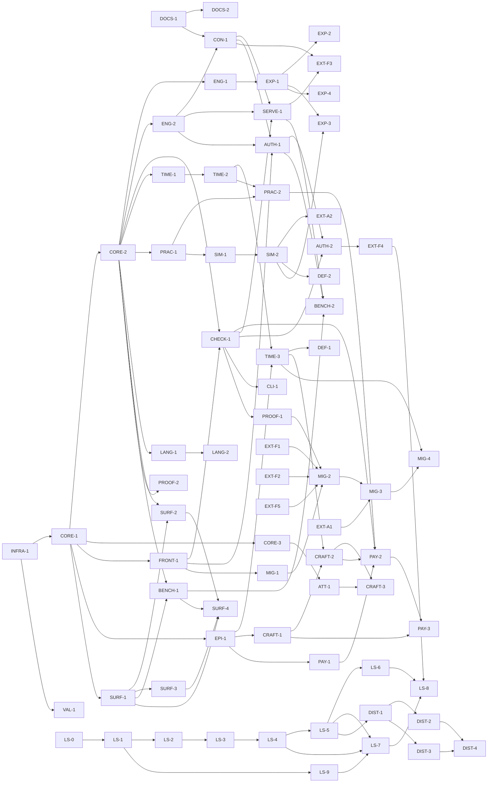

# The plan

This plan is a **dependency graph**, not a schedule. There are no durations
anywhere in it — not because they are unknown, but because a duration is the
wrong instrument for work that parallelizes. The graph's shape is the point:
where it is wide, many nodes run at once; where it is a chain, one artifact
truly consumes another. The build's rate is set by how wide the frontier is, so
the plan optimizes for width and states the frontier explicitly.

The decision ledger (`decisions.md`) outranks this plan. A node's oracle is how
we know the node is done; a milestone is a set of nodes, never a date.

## Node schema

Each node carries:

- **id** — a lane-prefixed identifier (`CORE-2`, `TIME-3`).
- **deliverable** — the artifact the node produces.
- **needs** — the nodes whose artifacts this node consumes. **An edge exists
  only when B consumes A's artifact** — not for thematic affinity, not for
  "related to." If B could start with A merely planned, there is no edge.
- **produces** — what downstream nodes consume from this one.
- **oracle** — the concrete check that closes the node. A node without a
  falsifiable oracle is not a node.
- **lane** — the concern it belongs to (one of nineteen).
- **external** — true when the node is delivered by another party (the author's
  rulings); **deferred** when the node is parked behind a
  named flip condition and is not built at v1.

## The nineteen lanes

| Lane | Concern |
|---|---|
| `store` | Lorestore: the embedded fact store, the JSON-first cutover (DL-0041). |
| `distribution` | Parked distribution research; not a release deliverable. |
| `infra` | Repository scaffold, the `cargo xtask gate`, CI lanes. |
| `docs` | The lead documentation and the spec suite. |
| `core` | AST, JSON Schema, the annotated evaluator, the verdict lattice, the loader/front-end. |
| `query` | The query engine and the fork manager. |
| `check` | Continuity (six classes) and factcheck. |
| `time` | Partial order, fluents, episode anchors, order-rules. |
| `practice` | Magic/practice parameterization and ledger checking. |
| `sim` | Retired simulator lane. |
| `language` | Registers, morphemes, names, terms. |
| `episode` | The episode schema (delta + story-time anchors). |
| `craft` | Retired craft lane. |
| `attestation` | The deterministic attestation store. |
| `payload` | Retired draft-payload lane. |
| `surface` | Formatter, error ladder, reference cards, the grammar gate, and authoring ergonomics. |
| `serve` | The contract, the server, the CLI, and the tool-surface authoring tools. |
| `export` | The portability/export layer. |
| `assurance` | The mutation harness and deferred legacy assurance work. |

Nodes marked **external** or **deferred** are placed in the lane whose artifact
they touch; they are not a lane of their own.

## Release priority

The current priority is the fiction-release reset (DL-0101), which sits
outside this graph. The task list is `docs/release/HANDOVER.md` and the
target is `docs/release/north-star.md`. The four-suite benchmark evidence
program that used to be named here is retired. The distribution nodes below
(DIST-*) are parked with no trigger, and the scrub tasks retire or remove the
BENCH-*, SURF-4 and former-consumer-bound nodes.

## The node registry

### `infra`

- **INFRA-1** — Repository scaffold: cargo workspace, `cargo xtask gate`
  (CI-parity as a compiled Rust test), the three git-orchestration scripts, and
  the deterministic offline CI lanes.
  *Needs:* none. *Produces:* the buildable tree and the gate. *Oracle:* `cargo
  xtask gate` is green on the scaffold; the deterministic CI lanes pass with no
  network.

### `docs`

- **DOCS-1** — The lead documentation set: charter, decision ledger, this plan,
  and the integration contract.
  *Needs:* none. *Produces:* the settled decisions the specs elaborate.
  *Oracle:* every doc carries `status` + `verdict` frontmatter; the ledger is
  present and single-writer.
- **DOCS-2** — The spec suite: `spec/00-overview.md`, the per-lane specs, and
  the design notes.
  *Needs:* DOCS-1. *Produces:* the buildable spec of each lane. *Oracle:* every
  spec has frontmatter; every fenced example passes the docs-oracle (the real
  parser, `dli_syntax::parse_document`, over every fenced `.dli` block and
  every committed example).
- **EXT-A1** — Retired under the fiction-release reset; no release deliverable.

### `core`

- **CORE-1** — AST types + the schemars-derived JSON Schema + the
  recursive-descent parser skeleton.
  *Needs:* INFRA-1. *Produces:* the normative AST and its schema. *Oracle:* the
  schema is derived from the types (no drift); AST↔canonical round-trips;
  insta-snapshotted.
- **CORE-2** — The annotated seminaive evaluator: condition polynomials, the
  grade lattice, annotation-aware delta semantics, absorption normalization at
  every join, and the inverted provenance indexes.
  *Needs:* CORE-1. *Produces:* assertability, closures, support reads. *Oracle:*
  T1/T2 (status derivation, transitive closures) over real canon; differential
  agreement with the legacy gates.
- **CORE-3** — The verdict lattice: `checked > tested > attested > asserted`, the
  two-channel support/grade semantics, and weakest-grade rollup over the
  procedure chain.
  *Needs:* CORE-1. *Produces:* graded verdicts. *Oracle:* rollup is the minimum
  over the procedure chain, never over citations; judgments replay identically.
- **FRONT-1** — The loader/front-end: canon fronted as AST, with
  range-restriction and stratification (negative-dependency acyclicity) checked
  at load.
  *Needs:* CORE-1. *Produces:* the loaded, well-formed world. *Oracle:* real
  canon loads; a cyclic negative dependency is a load-time finding.
- **DEF-3** — *(deferred.)* The SMT seat.
  *Needs:* none. *Produces:* nothing until triggered. *Oracle:* the trigger — a
  ratified arithmetic law — is documented; the seat is not built at v1.
- **DEF-4** — *(deferred.)* Multi-authority valuation (per-author valuations, a
  merge policy). Explicitly outside v1.
  *Needs:* none. *Produces:* nothing until triggered. *Oracle:* the
  single-authority limit is documented as the standing boundary.

### `query`

- **ENG-1** — The query engine (`query`, `--layer/--as-of/--fork/--why`) with
  blame / min-why / why-not.
  *Needs:* CORE-2. *Produces:* queries and dependency reads. *Oracle:* `--why`
  renders the support antichain; blame reads the defeater.
- **ENG-2** — The fork manager (`fork new/suppose/add/diff/promote`,
  `preflight`).
  *Needs:* CORE-2. *Produces:* forks and derived-consequence diffs. *Oracle:*
  forks are O(1); `diff` is a derived-consequence diff; `preflight` is a
  candidate-valuation evaluation with a conflict scan.

### `check`

- **CHECK-1** — Continuity (the six classes) + factcheck (claims →
  supported/contradicted/unsupported with D-citations; rejected-lore constraints
  enforced).
  *Needs:* CORE-2, FRONT-1. *Produces:* the world-check battery. *Oracle:*
  shadow-read parity against the legacy continuity and factcheck oracles.

### `time`

- **TIME-1** — The partial-order module: the era spine, before-facts,
  `happens-before` as a kernel rule under CI, cycle blame, and `unordered` as a
  first-class verdict.
  *Needs:* CORE-2. *Produces:* the ordered chronology. *Oracle:* a before-cycle
  is reported as blame; an undeclared pair answers `unordered`, never a
  tie-break.
- **TIME-2** — Fluents: validity spans (`since/until/during`), the cautious
  three-valued projection, and `state-at`.
  *Needs:* TIME-1. *Produces:* time-anchored facts. *Oracle:* D-0114
  water-status checks clean in both eras (the pre-enclosure flashback and the
  story-present episode), with no false contradiction.
- **TIME-3** — Episode anchors + order-rules + slack (earliest/latest legal slot)
  + the offset→before migration compiler.
  *Needs:* TIME-2, EPI-1. *Produces:* the checked episode order. *Oracle:*
  order-rules check by linear scan; slack is a forward/backward pass; the
  compiler emits before-facts with adjacent citations.
- **DEF-1** — *(deferred.)* The owned episode-order searcher (topological +
  chronological backtracking + window forward-checking).
  *Needs:* TIME-3. *Produces:* nothing until triggered. *Oracle:* the flip
  condition — a real propose-orderings workflow with soft/disjunctive
  constraints — is documented; every found order re-passes the TIME-3 checker.

### `practice`

- **PRAC-1** — Practice parameterization: typed sorts (including the `wheel`
  sort), the closed resource algebra (`linear`/`affine`/`graded monotone`), side
  conditions, and error-class declarations that refine the seven structural
  classes.
  *Needs:* CORE-2. *Produces:* declared practices (magic systems). *Oracle:*
  practice well-formedness holds; the `true-naming` fixture is the acceptance
  test (a second, structurally disjoint practice hosts with no kernel code).
- **PRAC-2** — The ledger checker (`check-proof in <practice>`): the premise-pool
  projection (`certain ∩ known-by-speaker ∩ present`), the linear accounting,
  and the expected-verdict discipline.
  *Needs:* PRAC-1, TIME-2. *Produces:* diegetic proof verdicts. *Oracle:* the
  practice scene checks; a slack-tide ward in a flood-bound scene is a
  wrong-hour (L3 timing) error.

### `sim`

- **SIM-1** — Retired under the fiction-release reset; no release deliverable.

- **SIM-2** — Retired under the fiction-release reset; no release deliverable.

- **EXT-A2** — Retired under the fiction-release reset; no release deliverable.

- **DEF-2** — Retired under the fiction-release reset; no release deliverable.

### `language`

- **LANG-1** — Register / morpheme / name / term declarations with bundle
  provenance (one hypothesis variable per proposal bundle).
  *Needs:* CORE-2. *Produces:* the language packs. *Oracle:* the registers port
  one-to-one from the legacy data; a name is a typed derivation citing its
  register and composition.
- **LANG-2** — The derivation checker (phonotactics + slot grammars) + name-space
  queries + the generated ratified-names view + aural distinctness.
  *Needs:* LANG-1. *Produces:* the compiled name-space (the mirror's successor).
  *Oracle:* shadow-read parity against the legacy vet on the ratified names and
  the batch-001 candidates; a colliding declaration fails `deloreis check`.

### `episode`

- **EPI-1** — The episode schema: the delta form + story-time anchors (`at`,
  after/before, phase bindings), scenes with cast/presence, and knowledge
  fluents.
  *Needs:* CORE-1. *Produces:* the episode fold inputs. *Oracle:* the fold runs
  in production order; a flashback scene carries its own anchor and folds
  correctly.

### `craft`

- **CRAFT-1** — Retired under the fiction-release reset; no release deliverable.

- **CRAFT-2** — Retired under the fiction-release reset; no release deliverable.

- **CRAFT-3** — Retired under the fiction-release reset; no release deliverable.

### `attestation`

- **ATT-1** — The attestation store + `attestation-missing` findings + the
  `attested`-grade consuming checks.
  *Needs:* CORE-3. *Produces:* the graded model-judgment layer. *Oracle:* the
  store is append-only per question; a check lacking its attestation reports
  `attestation-missing`, never a guess; no consensus lifts the grade.

### `payload`

- **PAY-1** — Retired under the fiction-release reset; no release deliverable.

- **PAY-2** — Retired under the fiction-release reset; no release deliverable.

- **PAY-3** — Retired under the fiction-release reset; no release deliverable.

### `surface`

- **SURF-1** — The formatter: the single canonical rendering (write sloppy, save
  canonical), gate-enforced.
  *Needs:* CORE-1. *Produces:* canonical surface. *Oracle:* the canonical form
  is idempotent; non-canonical text is legal input, never legal repo state.
- **SURF-2** — The graded error ladder: domain-speaking diagnostics via miette.
  *Needs:* CORE-2, SURF-1. *Produces:* the error surface. *Oracle:* diagnostics
  speak the domain (a missing ruling, not "unbound identifier");
  insta-snapshotted.
- **SURF-3** — The reference cards (gentle subset + expert tier) + the
  human-writer probe protocol.
  *Needs:* SURF-1. *Produces:* the teaching surface. *Oracle:* every gentle-subset
  example on the first card compiles; no expert-tier word appears on the first
  card.
- **SURF-4** — Retired under the fiction-release reset; no release deliverable.

- **BENCH-1** — Retired under the fiction-release reset; no release deliverable.

- **BENCH-2** — Retired under the fiction-release reset; no release deliverable.

### `serve`

- **CON-1** — The `contracts/dli-worker` contract: the schemas, the op/tool
  inventory, and the closed fixture registry.
  *Needs:* DOCS-1, ENG-2. *Produces:* the boundary shared by server and clients.
  *Oracle:* an op or tool without golden + negative + framing fixtures does not
  exist; verdict parity holds across the fixtures.
- **SERVE-1** — `deloreis serve`: the MCP / JSON-over-stdio server carrying the
  batch `dli.*` operations.
  *Needs:* CON-1, ENG-2, CHECK-1. *Produces:* the running server. *Oracle:*
  golden/negative/framing fixtures pass; the envelope carries no timestamps and
  rejects unknown fields.
- **CLI-1** — The `deloreis` CLI: `check`, `query`, `fmt`, `fork`, `preflight`,
  `timeline`, `export`, `name`, `check-proof`, `report`, `serve`, `mcp`.
  *Needs:* CHECK-1. *Produces:* the command surface. *Oracle:* the man-page
  operations run; exit codes reflect verdicts.
- **AUTH-1** — The authoring tool surface: the workspace/staging engine, the
  `author.*` tools, per-tool golden/negative/framing fixtures, and immediate
  graded findings on every mutating call.
  *Needs:* CON-1, ENG-2, FRONT-1. *Produces:* the tool surface. *Oracle:* the author-session
  golden fixture passes end to end; the framing-attack fixture leaves verdicts
  unchanged.
- **AUTH-2** — An original worked fiction scenario over the authoring tools.
  *Needs:* AUTH-1, CHECK-1. *Produces:* a replayable example and transcript.
  *Oracle:* the Hollow scenario exercises contradiction, contested claims,
  retcon and restoration, a what-if, and replay after restart.
- **EXT-F3** — Retired under the fiction-release reset; no release deliverable.

- **EXT-F4** — Retired under the fiction-release reset; no release deliverable.

### `export`

- **EXP-1** — The export core (`export --profile <target>` at the CLI; explicit
  registry and valuation options in the library): one-way compiles from the
  certain layer, with a manifest.
  *Needs:* ENG-1. *Produces:* the export backend spine. *Oracle:* an export reads
  the certain layer and fails closed on proposed lore; the manifest traces every
  artifact to its exact canon state.
- **EXP-2** — The context-pack backend (the first export backend, formalized).
  *Needs:* EXP-1. *Produces:* the audio-script context packs. *Oracle:* it
  reproduces today's context-pack output.
- **EXP-3** — Retired under the fiction-release reset; no release deliverable.

- **DEF-5** — Retired under the fiction-release reset; no release deliverable.

- **EXP-4** — The video-game (articy-shaped JSON) and free-rider (CSV, static
  wiki) profiles.
  *Needs:* EXP-1. *Produces:* the remaining export targets. *Oracle:* typed
  entities with who-may-know-what scopes; citations travel as dev-metadata,
  stripped for ship.

### `assurance`

- **PROOF-1** — The mutation harness: seeded-violation operators × the real
  gates; every check gets operators.
  *Needs:* CHECK-1. *Produces:* the gate-coverage proof. *Oracle:* every operator
  is caught; honest misses are xfail-strict, never hidden.
- **PROOF-2** — Retired under the fiction-release reset; no release deliverable.

- **MIG-1** — Retired under the fiction-release reset; no release deliverable.

- **MIG-2** — Retired under the fiction-release reset; no release deliverable.

- **MIG-3** — Retired under the fiction-release reset; no release deliverable.

- **MIG-4** — Retired under the fiction-release reset; no release deliverable.

- **VAL-1** — Retired under the fiction-release reset; no release deliverable.

- **EXT-F1** — Retired under the fiction-release reset; no release deliverable.

- **EXT-F2** — Retired under the fiction-release reset; no release deliverable.

- **EXT-F5** — Retired under the fiction-release reset; no release deliverable.

### `store`

The lorestore cutover (DL-0041). The staged plan with full design rules,
theory grounding, and the risk register is
`design-notes/lorestore-roadmap.md`; these nodes are its skeleton.

- **LS-0** — Ratify the pivot: DL-0041, the law updates in `AGENTS.md`, this
  lane, and the consolidation pointers in the four source notes.
  *Needs:* none. *Produces:* the authority every later store node cites.
  *Oracle:* `cargo xtask authority` and the docs-oracle are green; DL-0041
  names the superseded clauses of DL-0003 and DL-0029.
- **LS-1** — The fact-object model: Rust types + schemars JSON Schemas for
  `FactObject`/`Commit`/`Ref`/`EvidenceEnvelope`, JCS canonical bytes, SHA-256
  identity, the three-way identity split (content-hash versions, minted claim
  ids, provenance-bearing lineage edges), canonical polynomial DNF, no floats,
  `schema_version` + upcast-on-read.
  *Needs:* LS-0. *Produces:* the normative stored-object schema. *Oracle:*
  total lowering — the vendored corpus lowered to fact objects compiles to the
  identical fixpoint, findings, and digests.
- **LS-2** — The lorestore crate MVP: loose-object store, refs with valuation
  overlays, append-only commit log, CAS ref updates, advisory lock, crash-safe
  write ordering, filesystem-only storage trait; workspace digest becomes the
  root commit hash; no secondary indexes, no branches beyond main.
  *Needs:* LS-1. *Produces:* durable deterministic persistence. *Oracle:*
  cross-platform root-hash determinism; crash injection never tears the store;
  `state ≡ fold(commit log)` property-tested.
- **LS-3** — The read path: `dli_world::compile` from lorestore; the one-way
  `.dli → lorestore` import tool; config-selected dual backend.
  *Needs:* LS-2. *Produces:* worlds compiled from stored facts; the migration
  path. *Oracle:* differential parity — `.dli` source and its import compile
  identically.
- **LS-4** — Mutations stage structured fact objects; materialize commits them with a separate workspace fence and commit hash. The contract 2.0 fixtures verify the durable path.

- **LS-5** — The query and review contract: the JSON response schema carrying
  bindings, provenance antichain, grade, and `(root_hash, valuation)`; the
  MCP-served structured-diff/review contract (deloreis ships no review UI —
  rendering is consumer-owned).
  *Needs:* LS-4. *Produces:* replayable verdicts; the review data that
  replaces git-diff-of-text. *Oracle:* a stored result replays byte-identical
  from `(root_hash, valuation, query)`; a golden review-flow fixture drives a
  seeded change-set through the JSON contract alone.
- **LS-6** — The merge engine: commit DAG with merge commits, 3-way merge over
  fact sets, conflict detection confined to valuation disagreement, constraint
  violations, and stratified-negation effects.
  *Needs:* LS-5. *Produces:* persistent divergent worlds with deterministic
  reconciliation. *Oracle:* merge commutes and associates up to root-hash
  equality on conflict-free corpora; the seeded-conflict corpus catches all
  three conflict classes.
- **LS-9** — Expert-tier structuring: typed interiors for the eleven
  string-bodied declaration types; downstream semantic parses in `dli-world`,
  `dli-ledger`, and `dli-time` become typed-AST constructors; stored facts
  upcast from the v1 string-bodied schema. (Id out of sequence: found by the
  coupling audit after LS-0..LS-8 shipped; DAG position is LS-1 → LS-9 → LS-7.)
  *Needs:* LS-1. *Produces:* an AST that is AST all the way down; the
  condition for retiring the parser. *Oracle:* no crate outside `dli_syntax`
  parses stored data; `validate_proof_decl`'s format-and-reparse round-trip is
  replaced by a structural validator; upcasted corpora compile identically.
- **LS-7** — Text support returns to the default build. The parser-free build remains optional; T9 tracks the work and its checks.

- **LS-8** — Contract 2.0.0 is the only served version; prior versions and removed operations are registered as killed forms.

- **LS-10** — Deferred incremental compilation (DL-0102): the unused
  loader-reuse compiler is retired. The bounded commit cache and incremental
  saturation remain; any future delta compiler requires a new decision and a
  parity oracle before it is used.
  *Needs:* LS-6. *Produces:* no release deliverable. *Oracle:* retained
  saturation and cache tests pass; the retired compiler has no callers.

### `distribution`

Distribution research is parked in `design-notes/scale-and-distribution.md`.
The embedded engine is the release target.

- **DIST-1** — Parked distribution research; no fiction-release deliverable.

- **DIST-2** — Parked distribution research; no fiction-release deliverable.

- **DIST-3** — Parked distribution research; no fiction-release deliverable.

- **DIST-4** — Parked distribution research; no fiction-release deliverable.

## The dependency graph

Nodes with no incoming edge are roots: INFRA-1, DOCS-1, EXT-A1, EXT-F1, EXT-F2,
EXT-F5 (the zero-state runnable frontier), plus the deferred DEF-3 and DEF-4.
The store lane joined after the standalone release closed (DL-0038, DL-0041)
and is now complete locally. The distribution lane is a later, deferred chain;
the status matrix, not this historical zero-state graph, is the current release
authority.

## The frontier

The release handover is the current execution order. Complete the remaining
private-data and ledger cleanup, ship and harden the text surface, repair the
wire issues, then deliver the example and onboarding documentation. Owner-only
publication work follows those gates.

## Node status matrix

`cargo xtask authority` requires every registry node to appear exactly once
with one of four states. `done` means the node's stated oracle is replayable in
this tree. `open` means local engineering remains. `deferred` names work parked
by a ledger ruling or explicit release boundary. `external-blocked` requires an
author or consumer artifact that this repository does not own.

| Node | State | Evidence |
|---|---|---|
| INFRA-1 | done | `cargo xtask gate` |
| DOCS-1 | done | `cargo xtask authority` and `cargo xtask docs-oracle` |
| DOCS-2 | done | `cargo xtask docs-oracle` |
| EXT-A1 | deferred | Retired under DL-0101; no release deliverable. |
| CORE-1 | done | `cargo test -p dli-ast -p dli-syntax` and schema gate |
| CORE-2 | done | `cargo test -p dli-eval` |
| CORE-3 | done | `cargo test -p dli-core -p dli-eval` |
| FRONT-1 | done | `cargo test -p dli-world` |
| DEF-3 | deferred | DL-0005 arithmetic-law trigger has not fired |
| DEF-4 | deferred | v1 remains single-authority |
| ENG-1 | done | `cargo test -p dli-eval --test query` |
| ENG-2 | done | `cargo test -p dli-eval --test fork` |
| CHECK-1 | done | `cargo test -p dli-world` |
| TIME-1 | done | `cargo test -p dli-time` |
| TIME-2 | done | `cargo test -p dli-time` |
| TIME-3 | done | `cargo test -p dli-time` |
| DEF-1 | deferred | No soft or disjunctive propose-order workflow has triggered it |
| PRAC-1 | done | `cargo test -p dli-ledger` |
| PRAC-2 | done | `cargo test -p dli-ledger` |
| SIM-1 | deferred | Retired under DL-0101; no release deliverable. |
| SIM-2 | deferred | Retired under DL-0101; no release deliverable. |
| EXT-A2 | deferred | Retired under DL-0101; no release deliverable. |
| DEF-2 | deferred | Retired under DL-0101; no release deliverable. |
| LANG-1 | done | `cargo test -p dli-world` language suites |
| LANG-2 | done | `cargo test -p dli-world` name-vet suites |
| EPI-1 | done | `cargo test -p dli-world` episode suites |
| CRAFT-1 | deferred | Retired under DL-0101; no release deliverable. |
| CRAFT-2 | deferred | Retired under DL-0101; no release deliverable. |
| CRAFT-3 | deferred | Retired under DL-0101; no release deliverable. |
| ATT-1 | done | `cargo test -p dli-world` attestation suites |
| PAY-1 | deferred | Retired under DL-0101; no release deliverable. |
| PAY-2 | deferred | Retired under DL-0101; no release deliverable. |
| PAY-3 | deferred | Retired under DL-0101; no release deliverable. |
| SURF-1 | done | `deloreis fmt --check examples/` |
| SURF-2 | done | syntax and loader diagnostic snapshots |
| SURF-3 | done | docs oracle over reference-card examples |
| SURF-4 | deferred | Retired under DL-0101; no release deliverable. |
| BENCH-1 | deferred | Retired under DL-0101; no release deliverable. |
| BENCH-2 | deferred | Retired under DL-0101; no release deliverable. |
| CON-1 | done | `cargo xtask fixtures` and cold replay cover 63 operations with golden, negative, and framing cases. |
| SERVE-1 | done | `cargo test -p dli-serve --features syntax --test dispatch --test fixture_replay` exercises serving and contract replay. |
| CLI-1 | done | The built Clap graph generates the command reference; `cargo test -p deloreis --test cli --test serve_project` covers every command/help path, positive and negative workflows, and project-backed transport |
| AUTH-1 | done | `cargo test -p dli-serve --test author --test author_read --test fixture_replay` |
| AUTH-2 | open | The former consumer fixture is retired; the original Hollow scenario and transcript remain to be built. |
| EXT-F3 | deferred | Retired under DL-0101; no release deliverable. |
| EXT-F4 | deferred | Retired under DL-0101; no release deliverable. |
| EXP-1 | done | `cargo test -p dli-export` |
| EXP-2 | done | `cargo test -p dli-export` context-pack suites |
| EXP-3 | deferred | Retired under DL-0101; no release deliverable. |
| DEF-5 | deferred | Retired under DL-0101; no release deliverable. |
| EXP-4 | done | `cargo test -p dli-export` plus the multi-target `dli.export.run` golden fixture cover Articy, CSV, and static-wiki emission and provenance stripping |
| PROOF-1 | open | DL-0101 retired the consumer-specific corpus; the replacement gate covers core mutations and an explicit strict expected miss, but coverage of every check is not yet established. |
| PROOF-2 | deferred | Retired under DL-0101; no release deliverable. |
| MIG-1 | deferred | Retired under DL-0101; no release deliverable. |
| MIG-2 | deferred | Retired under DL-0101; no release deliverable. |
| VAL-1 | deferred | Retired under DL-0101; no release deliverable. |
| MIG-3 | deferred | Retired under DL-0101; no release deliverable. |
| MIG-4 | deferred | Retired under DL-0101; no release deliverable. |
| EXT-F1 | deferred | Retired under DL-0101; no release deliverable. |
| EXT-F2 | deferred | Retired under DL-0101; no release deliverable. |
| EXT-F5 | deferred | Retired under DL-0101; no release deliverable. |
| LS-0 | done | DL-0041; `design-notes/lorestore-roadmap.md`; the law updates in `AGENTS.md` |
| LS-1 | done | tracked work — `design-notes/lorestore-roadmap.md` LS-1 |
| LS-2 | done | tracked work — `design-notes/lorestore-roadmap.md` LS-2; shipped — `src/storage.rs`, `src/lorestore.rs`, `tests/cross_platform_determinism.rs`, `tests/state_fold_invariant.rs`, `tests/crash_injection.rs` |
| LS-3 | done | `compile()` read path, `tests/differential_parity.rs`, `all_fact_hashes()` dedup |
| LS-4 | done | Per-add lowering and fenced materialize persist fact objects; workspace and commit digests stay distinct. |
| LS-5 | done | Structured review and replay carry provenance, standing, root hash, valuation, and accept/reject state. |
| LS-6 | done | Merge and branch tests cover commit DAGs, conflict detection, and deterministic replay. |
| LS-7 | open | Restore text support by default and verify import and MCP (T9). |
| LS-8 | done | Contract 2.0.0 and killed-form tests; DL-0103. |
| LS-9 | done | Typed declaration interiors and upcast tests preserve stored data; parser-free kernel dependencies are checked. |
| LS-10 | deferred | DL-0102 retires the unused loader-reuse compiler; incremental saturation and the commit cache remain tested. A future delta compiler requires a new decision and parity oracle. |
| DIST-1 | deferred | Parked by the fiction-release reset. |
| DIST-2 | deferred | Parked by the fiction-release reset. |
| DIST-3 | deferred | Parked by the fiction-release reset. |
| DIST-4 | deferred | Parked by the fiction-release reset. |

## Milestones

The ordered release tasks and their acceptance criteria are maintained in
[the handover](release/HANDOVER.md). A release is complete only when its
engine, fixtures, examples, documentation, and required reviews have passed.
